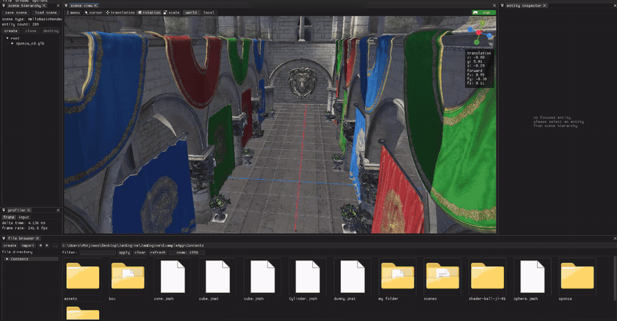
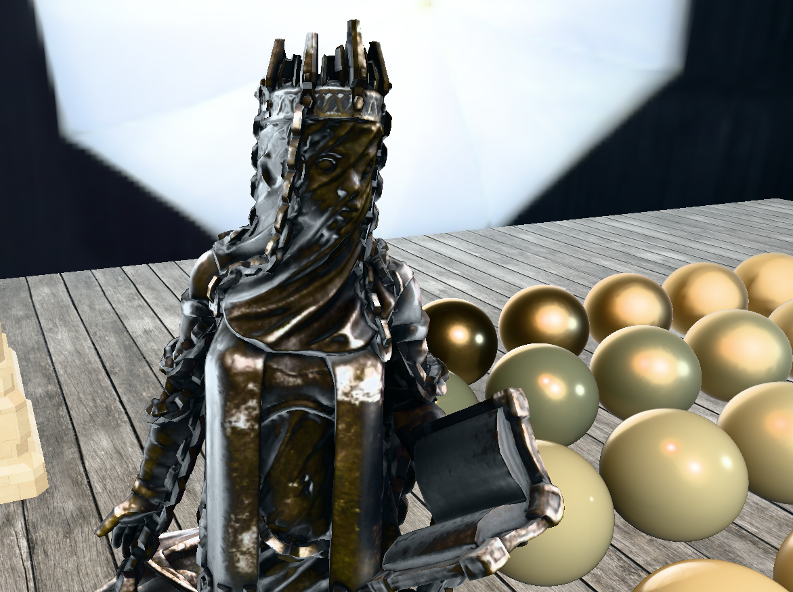
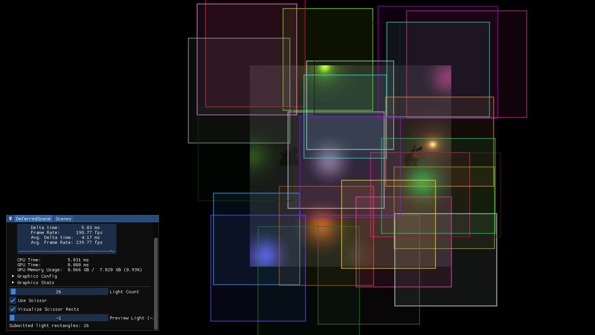
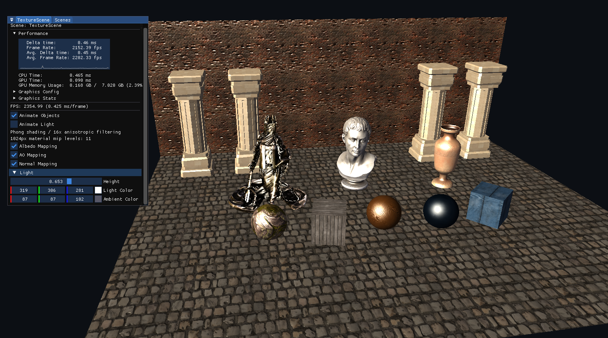

<h1 align="center">JamEngine</h1>

<p align="center">Direct3D 11 기반 C++20 게임 개발 프레임워크</p>

<p align="center">
  
  
  
  
</p>


## Contents

* [프로젝트 소개](#프로젝트-소개)
* [에디터](#에디터)
* [컴포넌트 리플렉션](#컴포넌트-리플렉션)
* [렌더 그래프](#렌더-그래프)
* [렌더링 샘플](#렌더링-샘플)
* [빌드 및 실행](#빌드-및-실행)

## 프로젝트 소개

부경대학교 캡스톤디자인 경진대회 출품을 위해 9개월간 개발한 Direct3D 11 기반 게임 엔진 프레임워크입니다.

- 에디터에서 모델을 임포트해 씬을 구성하고, 엔티티에 컴포넌트와 스크립트를 붙여 실행할 수 있습니다.
- 컴포넌트는 메타데이터만 등록하면 인스펙터, 씬 직렬화, 엔티티 복제에 자동으로 연결됩니다.
- 렌더 그래프가 패스 간 자원 의존성을 분석해 바인딩과 해제를 자동으로 처리합니다.
- `SandboxApp`에서 PBR, 디퍼드 조명, 그림자, SSAO, SSR, GPU 파티클 등 렌더링 샘플을 실행할 수 있습니다.

| 모듈 | 역할 |
| --- | --- |
| [`Application`](JamEngine/Application.h), [`SceneManager`](JamEngine/SceneManager.h) | 창과 서브시스템 초기화, 메인 루프, 씬 전환 |
| [`Scene`](JamEngine/Scene.h), [`Entity`](JamEngine/Entity.h) | EnTT 기반 ECS, 부모·자식 씬 그래프와 로컬·월드 트랜스폼 |
| [`AssetManager`](JamEngine/AssetManager.h) | 모델·메시·재질·텍스처 관리, 모델 노드 구조로 엔티티 계층 생성 |
| [`Graphics`](JamEngine/Graphics.h) | D3D11 리소스의 핸들 기반 관리, 드로우·디스패치 제출 |
| [`RenderGraph`](JamEngine/RenderGraph.h) | 패스 컬링, 리소스 바인딩·해제 명령 생성 |

그 외에 수학 라이브러리, 바운딩 볼륨과 옥트리, 파일 감시, JSON 아카이브, 메모리 풀이 포함되어 있습니다. 단위 테스트는 `JamTest`, 벤치마크는 `JamBenchmark` 프로젝트에 있습니다.

## 에디터

ImGui로 만든 에디터입니다. 씬 계층, 씬 뷰, 인스펙터, 파일 브라우저, 프로파일러 창으로 구성됩니다.

### 엔티티 편집


씬 계층 창에서 엔티티를 생성·복제·삭제하고 부모·자식 관계를 편집합니다. 씬 뷰에서는 기즈모로 트랜스폼을 조작하며, 월드 기준과 로컬 기준을 전환할 수 있습니다. 인스펙터의 컴포넌트 목록과 편집 패널은 [컴포넌트 리플렉션](#컴포넌트-리플렉션) 정보로 만들어집니다.

### 모델 임포트


파일 브라우저에서 FBX 모델을 임포트하면 엔진 전용 포맷인 메시(`.jmsh`), 재질(`.jmat`), 모델(`.jmdl`) 파일이 생성됩니다. 모델을 씬에 배치하면 원본의 노드 구조대로 엔티티 계층이 만들어집니다. 재질 슬롯에 텍스처를 지정하면 씬 뷰에 바로 반영됩니다.

### 씬 저장과 실행



씬은 파일로 저장하고 다시 불러올 수 있습니다. Run 버튼을 누르면 카메라 컴포넌트가 붙은 엔티티의 시점으로 게임이 실행되고, Edit 버튼으로 편집 모드에 돌아옵니다.

### 스크립트


게임 로직은 `OnStart`, `OnUpdate`, `OnStop`을 오버라이드한 스크립트 클래스로 작성하고, 스크립트 컴포넌트로 엔티티에 붙입니다. 위 장면은 방향키로 큐브를 움직이는 스크립트입니다.

## 컴포넌트 리플렉션

컴포넌트 종류가 늘어날 때마다 인스펙터, 씬 직렬화, 엔티티 복제 코드에 타입별 분기를 추가하지 않도록 리플렉션 시스템을 만들었습니다. 각 컴포넌트가 메타데이터를 등록하면 엔진은 시작 시점에 타입별 함수 테이블을 구성하고, 엔진 코드는 이 테이블만 사용합니다.

카메라, 렌더러블, 조명, 태그 등 모든 컴포넌트가 같은 방식으로 선언됩니다. 아래는 점광원 컴포넌트의 예입니다.

```cpp
struct PointLightComponent
{
    JAM_COMPONENT_BODY(PointLightComponent);
    JAM_COMPONENT_DISPLAY_NAME("point light component");
    JAM_COMPONENT_PROPERTY_FLAGS(eComponentPropertyFlags::Serializable, eComponentPropertyFlags::Editable);

    void Serialize(ArchiveWriter& _writer, Scene* _pScene, Entity _owner) const;
    void Deserialize(ArchiveReader& _reader, Scene* _pScene, Entity _owner);
    void DrawEditPanel(Scene* _pScene, Entity _entity);

    Vec3  radiance     = Vec3::kZero;
    float intensity    = 1.0f;
    float fallOffStart = 1.0f;
    float fallOffEnd   = 10.0f;
};
```

- 등록: `JAM_COMPONENT_BODY`가 `inline static` 등록 객체를 만들고, 이 객체가 정적 초기화 시점에 [`ComponentDatabase`](JamEngine/ComponentDatabase.h)에 타입을 등록합니다. 생성, 복사, 제거, 조회 함수는 템플릿으로 만들어 `Delegate`에 저장됩니다.
- 플래그: `Serializable`을 선언하면 직렬화 함수가, `Editable`을 선언하면 인스펙터 편집 함수가 함께 등록됩니다.
- 컴파일 타임 검증: 플래그에 필요한 함수가 없으면 `static_assert`가 컴포넌트 이름과 함께 빌드를 실패시킵니다. [플래그 검증](JamEngine/ComponentMetadata.h)

엔진 코드는 타입을 모른 채 이 테이블을 순회합니다. 인스펙터는 편집 함수를, 씬 저장은 직렬화 함수를 호출합니다. 엔티티 복제는 원본이 가진 컴포넌트를 복사 함수로 복제하고 자식 엔티티도 재귀적으로 복제합니다. 새 컴포넌트를 추가해도 이 코드들은 수정하지 않습니다. [엔티티 복제](JamEngine/Scene.cpp)

## 렌더 그래프

D3D11에서는 같은 텍스처를 렌더 타깃(RTV)과 셰이더 리소스(SRV)로 동시에 바인딩할 수 없습니다. 디퍼드 조명이나 SSAO처럼 패스가 여러 개면, 패스마다 이전 바인딩을 해제하는 코드를 직접 관리해야 해서 패스를 추가하거나 순서를 바꿀 때 실수가 잦았습니다.

[`RenderGraph`](JamEngine/RenderGraph.h)에서는 패스가 읽고 쓰는 리소스를 이름으로 선언하기만 하면 됩니다. 아래는 SSAO 샘플에서 G-buffer의 노멀과 깊이를 읽는 패스입니다.

```cpp
m_graph.AddRenderPass("Pass_Ssao")
    .SetFrameBuffer("FB_Ssao")
    .SetProgram("P_Ssao")
    .SetTexture("T_GNormal", eShader::PixelShader, 0)
    .SetTexture("T_GDepth", eShader::PixelShader, 1)
    .SetConstantBuffer("CB_Ssao", eShader::PixelShader, CBSsao::kSlot)
    .SetExecutor(Bind<&SSAOScene::SubmitSsao_>(this));
```

그래프는 패스 구성이 바뀔 때만 컴파일되고, 컴파일은 두 단계로 진행됩니다.

1. 패스 컬링: 최종 출력 패스와 부수 효과가 있는 패스에서 리소스 의존성을 역방향으로 탐색합니다. 도달하지 않은 패스는 결과가 쓰이지 않으므로 실행 목록에서 제외합니다.
2. 바인딩 명령 생성: 남은 패스를 순서대로 따라가며 슬롯별 바인딩 상태를 추적합니다. RTV로 묶인 리소스를 읽기 전에는 RTV를, SRV로 묶인 리소스에 쓰기 전에는 SRV를 해제하는 명령을 기록합니다. 이미 같은 슬롯에 묶인 리소스는 다시 바인딩하지 않습니다. 프레임 경계에서도 충돌이 없도록 추적을 두 번 돌립니다.

런타임에는 미리 만든 명령만 순서대로 실행하므로 매 프레임 의존성을 다시 계산하지 않습니다. 창 크기가 바뀌면 화면 크기에 맞춘 텍스처만 다시 만듭니다. [렌더 그래프 구현](JamEngine/RenderGraph.cpp)

## 렌더링 샘플

SandboxApp의 Scenes 창에서 샘플을 선택합니다. 모든 샘플은 같은 `Scene` 인터페이스를 구현하며, 멀티 패스 샘플은 렌더 그래프로 구성했습니다.

### InstancingScene


큐브 65,536개의 월드 행렬을 인스턴스 버퍼에 모아 드로우 콜 한 번으로 그립니다. 큐브마다 드로우 콜을 호출할 때 190–210 FPS였고, 인스턴싱 적용 후 550–600 FPS로 약 2.9배 빨라졌습니다.

### PBRScene

<table width="100%">
  <tbody>
    <tr>
      <td align="center"></td>
      <td align="center"></td>
    </tr>
  </tbody>
</table>

Metallic·Roughness 워크플로의 PBR에 IBL을 적용했습니다. 디퓨즈는 Irradiance 맵, 스페큘러는 Prefiltered 환경 맵과 BRDF LUT로 계산합니다. 두 그림은 같은 동상을 서로 다른 환경 맵으로 렌더링한 결과입니다.

### DeferredScene

<table width="100%">
  <tbody>
    <tr>
      <td align="center"></td>
      <td align="center"></td>
    </tr>
  </tbody>
</table>

G-buffer에 색상, 노멀, 깊이를 기록한 뒤 광원마다 조명을 누적합니다. 점광원의 영향 범위를 화면에 투영해 Scissor Rect를 지정하고, 그 안의 픽셀만 조명을 계산합니다. 화면 밖에 있는 광원은 건너뜁니다. 오른쪽 그림의 색 사각형이 광원별 계산 영역입니다. 점광원 2,048개에서 약 240 FPS입니다.

### ShadowScene


광원 종류별로 다른 섀도 매핑을 사용합니다.

- 점광원: 6방향 깊이를 텍스처 배열에 담는 Omni Shadow Mapping
- 스팟라이트: 단일 섀도 맵
- 방향광: 시야 거리를 4개 구간으로 나눈 Cascaded Shadow Mapping

필터는 Hard, PCF(3×3, 5×5, 7×7), VSM 중에서 선택할 수 있습니다.

### CullingScene


오브젝트 20만 개를 옥트리에 넣고, 프러스텀 밖에 있는 노드는 하위 오브젝트까지 한 번에 제외합니다.

| 컬링 방식 | 평균 FPS | 프레임 시간 |
| --- | ---: | ---: |
| 컬링 없음 | 71.44 | 14.0 ms |
| 오브젝트별 선형 검사 | 86.92 | 11.5 ms |
| 옥트리 | 97.20 | 10.3 ms |

### SSAOScene


깊이 버퍼로 뷰 공간 위치를 복원하고, 노멀 방향 반구에 샘플을 뿌려 주변 지오메트리에 가려지는 비율로 차폐를 구합니다. 노이즈 텍스처로 샘플 커널을 회전시키고, 블러를 거친 결과를 앰비언트 조명에 적용합니다. 위 그림은 AO 값만 출력한 화면입니다.

### SSRScene


반사 방향으로 화면 공간 레이 마칭을 하며 깊이 버퍼와 교차하는 지점의 색을 가져옵니다. 화면 가장자리나 교차 판정이 불확실한 곳은 반사 강도를 줄여 경계가 끊겨 보이지 않게 했습니다.

### ParticleScene


파티클의 위치, 속도, 회전, 수명을 구조화 버퍼에 저장하고 컴퓨트 셰이더로 갱신합니다. 정점 셰이더가 같은 버퍼를 직접 읽기 때문에 CPU로의 readback이 없고, `DrawInstancedIndirect` 한 번으로 전체를 그립니다. 파티클 10만 개에서 약 2,400 FPS입니다.

### MousePickingScene


MRT로 색상과 오브젝트 ID(`R32_UINT`)를 동시에 기록합니다. 클릭한 위치의 ID 한 픽셀만 CPU로 읽어 오브젝트를 선택합니다. 아웃라인은 후처리에서 ID 버퍼를 읽어, 선택된 ID와 다른 ID가 맞닿은 경계 픽셀을 칠해 그립니다.

### 기타 샘플

<table width="100%">
  <tbody>
    <tr>
      <td align="center" width="50%"></td>
      <td align="center" width="50%"></td>
    </tr>
    <tr>
      <td>SimpleScene: 모델 로딩, 트랜스폼, 노멀 기반 조명</td>
      <td>MultiVertexStreamScene: 위치와 색상을 별도 정점 버퍼 슬롯으로 전달</td>
    </tr>
    <tr>
      <td align="center" width="50%"></td>
      <td align="center" width="50%"></td>
    </tr>
    <tr>
      <td>TextureScene: 알베도, 노멀, AO 텍스처 매핑</td>
      <td>StencilScene: 스텐실 버퍼를 이용한 평면 반사와 아웃라인</td>
    </tr>
    <tr>
      <td align="center" width="50%"></td>
      <td align="center" width="50%"></td>
    </tr>
    <tr>
      <td>TerrainScene: Perlin Noise 하이트맵, 높이·경사에 따른 텍스처 블렌딩</td>
      <td>SkinningScene: 선형 블렌드 스키닝, 대기·걷기·공격 애니메이션 간 전환 블렌딩</td>
    </tr>
  </tbody>
</table>

## 빌드 및 실행

Windows x64, C++20 환경에서 빌드합니다. Visual Studio 2026(플랫폼 도구 집합 `v145`)의 "C++를 사용한 데스크톱 개발" 워크로드가 필요합니다. 외부 라이브러리는 vcpkg의 Visual Studio 통합으로 참조하며, 링크 목록(DirectXTex, DirectXMesh, Assimp, fmt, spdlog, EASTL, efsw, lunasvg, yyjson)은 [`Directory.Build.targets`](Directory.Build.targets)에 있습니다.

1. 저장소를 받습니다.

   ```powershell
   git clone https://github.com/JuggernautSensei/JamEngine.git
   ```

2. `JamEngine.sln`을 열고 `SandboxApp`을 시작 프로젝트로 지정합니다.
3. `Release | x64`로 빌드한 뒤 실행합니다. 명령줄에서는 다음 스크립트를 사용합니다.

   ```powershell
   powershell -NoProfile -File scripts/Build.ps1 -Configuration Release
   ```

실행 후 Scenes 창에서 샘플을 고르고, W, A, S, D, Q, E로 카메라를 움직입니다.
