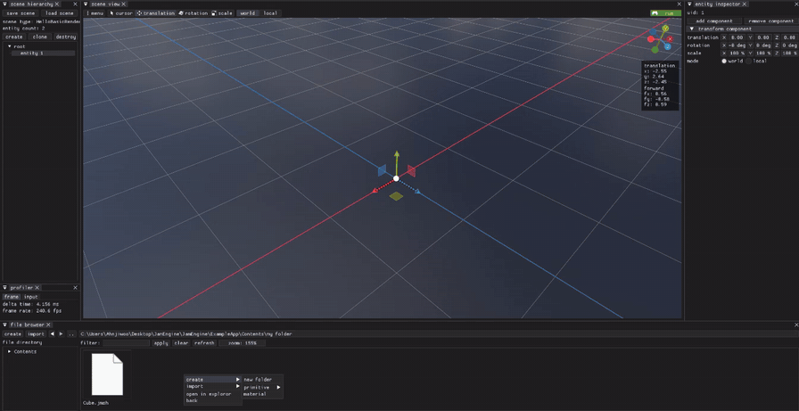
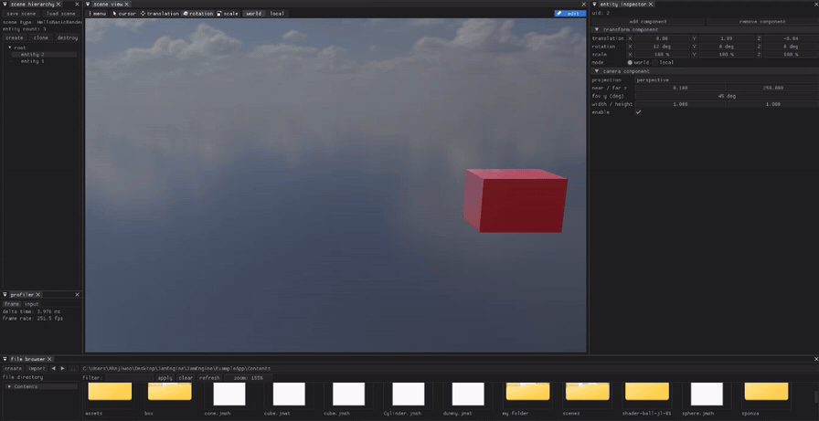
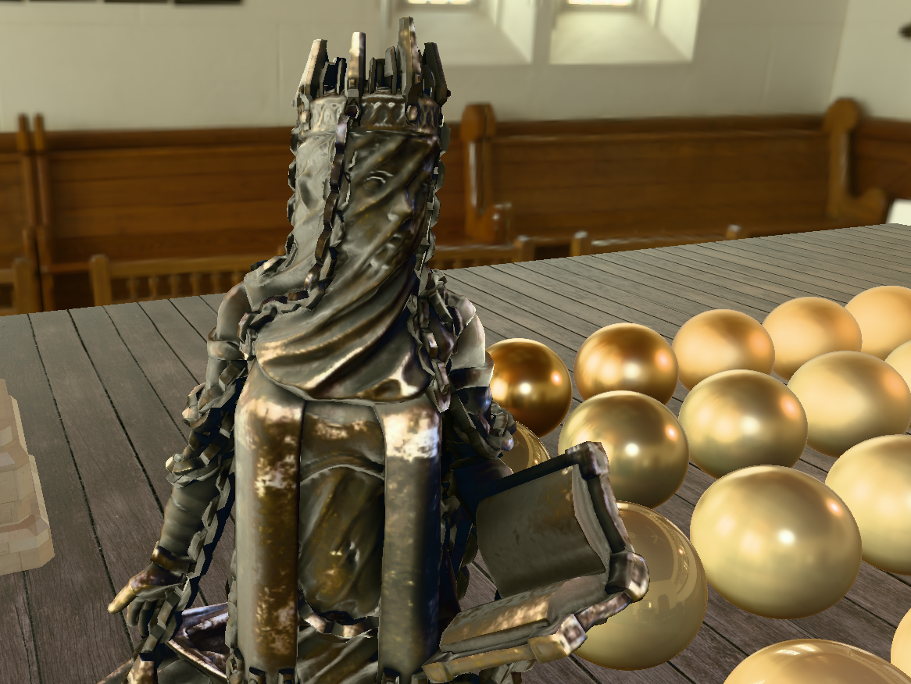
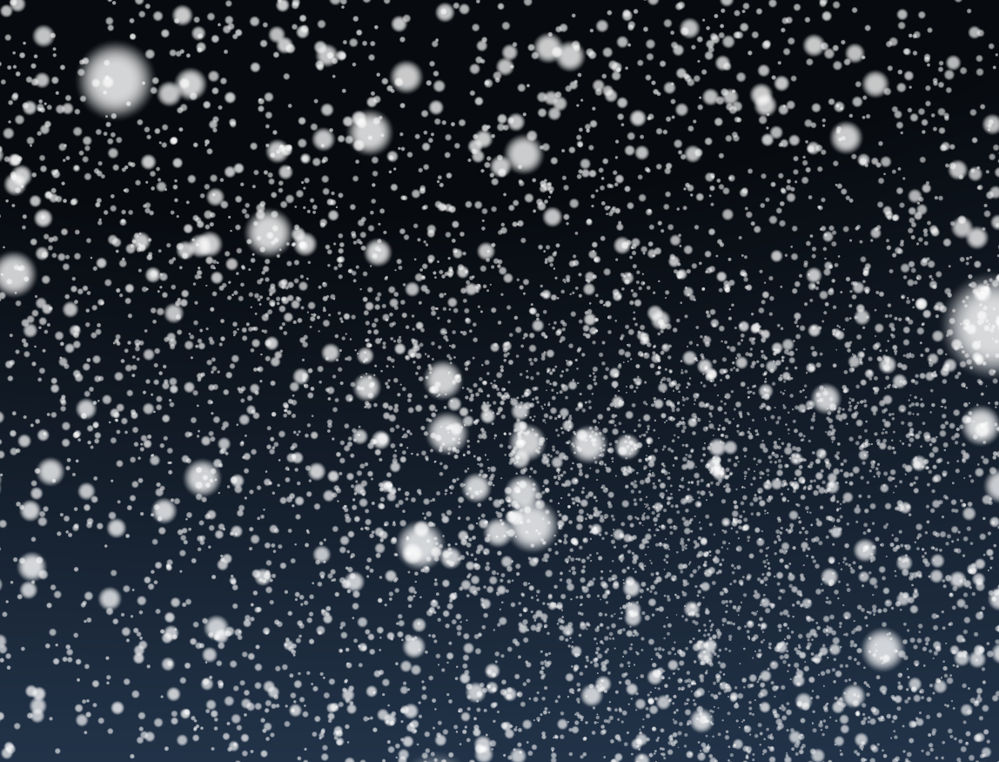
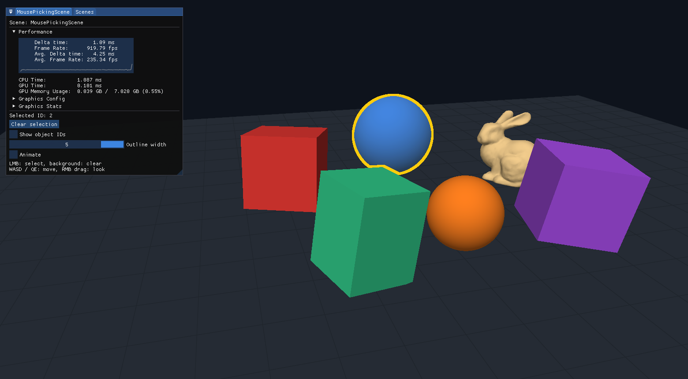

<h1 align="center">JamEngine</h1>

<p align="center">D3D11 기반 C++20 게임 개발 프레임워크</p>

<p align="center">
  
  
  
  
</p>


## Contents

* [프로젝트 소개](#프로젝트-소개)
* [에디터](#에디터)
* [컴포넌트 리플렉션](#컴포넌트-리플렉션)
* [렌더 그래프](#렌더-그래프)
* [렌더링 샘플](#렌더링-샘플)
* [빌드 및 실행](#빌드-및-실행)

## 프로젝트 소개

부경대학교 캡스톤디자인 경진대회 출품을 위해 9개월간 개발한 D3D11 기반 게임 엔진 프레임워크입니다. 정적 라이브러리 `JamEngine`은 엔티티와 씬 계층, 에셋 로딩, D3D11 렌더링을 담당합니다. `SandboxApp`에서는 이 엔진으로 구현한 PBR, 디퍼드 조명, GPU 파티클 등의 샘플 씬을 실행할 수 있습니다. 개발 중 만든 씬 에디터의 모델 임포트와 씬 편집·실행 과정은 아래 GIF에서 볼 수 있습니다.

<table width="100%">
  <thead>
    <tr>
      <th align="left">모듈</th>
      <th align="left">역할</th>
    </tr>
  </thead>
  <tbody>
    <tr>
      <td><a href="JamEngine/Application.h"><code>Application</code></a>, <a href="JamEngine/SceneManager.h"><code>SceneManager</code></a></td>
      <td>창과 하위 시스템 초기화, 메인 루프, 씬 전환</td>
    </tr>
    <tr>
      <td><a href="JamEngine/Scene.h"><code>Scene</code></a>, <a href="JamEngine/Entity.h"><code>Entity</code></a></td>
      <td>EnTT 기반 엔티티·컴포넌트, 부모·자식 씬 그래프와 로컬·월드 변환</td>
    </tr>
    <tr>
      <td><a href="JamEngine/AssetManager.h"><code>AssetManager</code></a></td>
      <td>모델, 메시, 재질, 텍스처를 경로로 관리하고 모델의 노드 구조로 엔티티 생성</td>
    </tr>
    <tr>
      <td><a href="JamEngine/Graphics.h"><code>Graphics</code></a></td>
      <td>D3D11 버퍼, 텍스처, 셰이더, 렌더 상태를 핸들로 관리하고 드로우·디스패치 제출</td>
    </tr>
    <tr>
      <td><a href="JamEngine/RenderGraph.h"><code>RenderGraph</code></a></td>
      <td>출력에 필요한 패스와 부수 효과가 있는 패스를 선별하고 자원 바인딩·해제 명령을 생성</td>
    </tr>
  </tbody>
</table>

이 밖에 수학(벡터, 행렬, 사원수), 바운딩 볼륨과 옥트리, 파일 감시, JSON 아카이브, 메모리 풀 같은 기반 모듈이 엔진에 포함되어 있습니다. `JamTest`에 단위 테스트가, `JamBenchmark`에 수학·문자열·옥트리 등의 벤치마크가 있습니다.

## 에디터

개발 중 제작한 ImGui 에디터의 데모입니다. 씬 뷰와 계층 트리에서 엔티티를 배치하고, 인스펙터에서 컴포넌트를 편집한 뒤 씬을 저장하고 실행하는 흐름을 담았습니다. 현재 솔루션의 실행 프로젝트인 `SandboxApp`에서는 샘플 씬을 선택해 볼 수 있습니다.

### 씬 구성

씬 계층에서 엔티티를 만들거나 복제하고, 씬 뷰의 기즈모로 이동·회전·크기를 조절합니다. 인스펙터에서는 렌더러블 컴포넌트를 추가해 엔티티에 메시와 재질을 지정할 수 있습니다.



FBX 모델을 임포트하면 엔진 형식의 모델·메시·재질 파일이 만들어집니다. 모델을 씬에 놓으면 원본 모델의 노드 구조대로 엔티티 계층이 생성됩니다. 아래 영상에서는 배치한 모델의 재질 슬롯에 텍스처를 지정하는 순간 화면에 변경이 반영됩니다.


### 씬 저장과 실행

씬을 파일에 저장하면 엔티티 계층과 컴포넌트 값을 다시 불러올 수 있습니다. 아래 영상은 Sponza 씬을 복원하고 카메라 컴포넌트를 추가한 뒤, `Run`으로 해당 카메라의 게임 화면을 확인하는 과정입니다.


실행 모드에서는 엔티티에 붙인 게임 로직도 확인할 수 있습니다. 다음 영상의 큐브는 방향키 입력에 따라 이동하며, `Edit`으로 돌아가면 다시 에디터 시점에서 씬을 살펴볼 수 있습니다.



## 컴포넌트 리플렉션

컴포넌트를 추가할 때마다 인스펙터, 씬 저장, 엔티티 복제에 타입별 분기를 추가하는 일을 줄이기 위해 [`ComponentDatabase`](JamEngine/ComponentDatabase.h)를 만들었습니다. 컴포넌트는 표시 이름과 지원 기능을 선언하고, 데이터베이스는 타입별 함수 테이블을 구성합니다. 아래 점광원 컴포넌트는 직렬화와 편집을 모두 선언합니다.

```cpp
struct PointLightComponent
{
    JAM_COMPONENT_BODY(PointLightComponent);
    JAM_COMPONENT_DISPLAY_NAME("point light component");
    JAM_COMPONENT_PROPERTY_FLAGS(eComponentPropertyFlags::Serializable, eComponentPropertyFlags::Editable);

    void Serialize(ArchiveWriter& _writer, Scene* _pScene, Entity _owner) const;
    void Deserialize(ArchiveReader& _reader, Scene* _pScene, Entity _owner);
    void DrawEditPanel(Scene* _pScene, Entity _entity);

    Vec3  radiance     = Vec3::kZero;
    float intensity    = 1.0f;
    float fallOffStart = 1.0f;
    float fallOffEnd   = 10.0f;
};
```

`JAM_COMPONENT_BODY`가 생성하는 정적 등록 객체는 타입별 생성·조회·복사 함수 등을 `Delegate`로 저장합니다. `Serializable`을 선언하면 `Serialize`와 `Deserialize`가, `Editable`을 선언하면 `DrawEditPanel`이 같은 테이블에 등록됩니다. 플래그에 필요한 함수가 빠지면 컴파일 단계에서 검증에 실패합니다. [등록 매크로와 플래그 검증](JamEngine/ComponentMetadata.h)

인스펙터를 구성할 때는 등록된 표시 이름과 편집 함수를, 컴포넌트 데이터를 저장하고 복원할 때는 직렬화 함수를 사용할 수 있습니다. 엔티티 복제에서는 실제로 이 테이블을 순회해 원본에 붙은 컴포넌트를 찾고, 점광원 같은 일반 컴포넌트는 등록된 복사 생성 함수로 복제합니다. 자식 엔티티도 재귀적으로 복제해 부모·자식 관계를 다시 연결합니다. [엔티티 복제 구현](JamEngine/Scene.cpp)

## 렌더 그래프

디퍼드 조명이나 SSAO처럼 여러 패스가 앞 패스의 결과를 읽는 렌더링에서는, 패스마다 렌더 타깃과 텍스처를 바인딩하고 해제하는 코드가 길어집니다. D3D11은 같은 텍스처를 렌더 타깃과 셰이더 입력으로 동시에 바인딩할 수 없으므로, 이전 패스에서 쓴 텍스처를 읽기 전에 렌더 타깃에서 풀어야 하고, 반대로 읽던 텍스처에 쓰기 전에는 셰이더 입력에서 풀어야 합니다. 패스를 추가하거나 순서를 바꿀 때마다 이 해제 코드를 다시 맞추는 것은 실수가 생기기 쉬웠습니다.

[`RenderGraph`](JamEngine/RenderGraph.h)에서는 각 패스가 무엇을 읽고 어디에 쓰는지만 이름으로 선언합니다. 아래는 SSAO 샘플의 일부입니다.

```cpp
m_graph.AddRenderPass("Pass_Ssao")
    .SetFrameBuffer("FB_Ssao")
    .SetProgram("P_Ssao")
    .SetTexture("T_GNormal", eShader::PixelShader, 0)
    .SetTexture("T_GDepth", eShader::PixelShader, 1)
    .SetConstantBuffer("CB_Ssao", eShader::PixelShader, CBSsao::kSlot)
    .SetExecutor(Bind<&SSAOScene::SubmitSsao_>(this));
```

SSAO 샘플에서는 G-buffer 패스가 기록한 노멀과 깊이를 SSAO 패스가 읽습니다. 이어서 블러 패스가 차폐 결과를 정리하고, 합성 패스가 이를 주변광에 반영합니다. 그래프는 처음 실행될 때와 패스 구성이 바뀔 때 이 자원 사용 관계를 바탕으로 실행 명령을 준비합니다. [SSAO 패스 구성](SandboxApp/SSAOScene.cpp)

먼저 쓰이지 않는 패스를 제거합니다. 자원 이름으로 "이 패스가 읽는 자원을 어느 패스가 쓰는가"를 따라 역방향 간선을 만들고, 화면에 출력하는 최종 패스와 부수 효과가 있다고 표시한 패스에서 역방향으로 탐색합니다. 탐색에 닿지 않은 패스는 결과가 아무 데도 쓰이지 않으므로 실행 목록에서 빠집니다. 예를 들어 결과를 화면에 내보내지 않는 시각화 패스를 꺼 두면, 그 패스만 쓰던 앞 단계 패스도 함께 실행 목록에서 빠집니다.

다음으로 남은 패스를 등록 순서대로 따라가며 슬롯마다 현재 어떤 자원이 어떤 용도로 바인딩되어 있는지 가상으로 추적합니다. 읽으려는 자원이 렌더 타깃이나 쓰기 가능 버퍼로 묶여 있으면 그 바인딩을 먼저 해제하는 명령을, 쓰려는 자원이 셰이더 입력으로 묶여 있으면 그 슬롯을 해제하는 명령을 패스에 기록합니다. 같은 자원이 이미 같은 슬롯에 읽기용으로 묶여 있으면 바인딩 명령을 생략합니다. 마지막 패스의 바인딩 상태가 다음 프레임의 첫 패스까지 이어지므로 이 추적을 두 바퀴 돌리고, 두 번째 바퀴의 해제 목록을 사용합니다.

실행 시에는 컴파일 결과의 명령만 순서대로 적용하므로 매 프레임 의존성을 다시 계산하지 않습니다. 창 크기가 바뀌면 크기를 따라가도록 지정한 텍스처와 프레임 버퍼만 다시 만들고, 패스 구조는 그대로 둔 채 핸들 값만 갱신합니다.

## 렌더링 샘플

SandboxApp의 Scenes 창에서 샘플을 고를 수 있습니다. 모든 샘플은 같은 `Scene` 인터페이스를 구현하고, 여러 패스가 필요한 샘플은 렌더 그래프로 구성했습니다.

### InstancingScene


같은 큐브 65,536개를 그립니다. 큐브마다 변환 행렬을 갱신하고 드로우를 호출하면 190–210 FPS, 변환 행렬을 인스턴스 버퍼에 모아 드로우 한 번으로 그리면 550–600 FPS입니다. 범위의 중간값으로 프레임 시간을 비교하면 5.0 ms → 1.7 ms(약 2.9배)입니다.

### PBRScene

<table width="100%">
  <tbody>
    <tr>
      <td align="center"></td>
      <td align="center"></td>
    </tr>
  </tbody>
</table>

Metallic과 Roughness를 쓰는 물리 기반 렌더링에 IBL을 더했습니다. 확산광은 Irradiance 맵으로, 정반사는 Roughness별로 필터링한 환경 맵과 BRDF LUT로 근사하므로, 환경을 바꾸면 같은 동상에 비치는 색과 밝기가 달라집니다.

### DeferredScene

<table width="100%">
  <tbody>
    <tr>
      <td align="center"></td>
      <td align="center"></td>
    </tr>
  </tbody>
</table>

색상, 노멀, 깊이를 G-buffer에 기록한 뒤 광원마다 조명을 더합니다. 점광원은 영향 반경이 정해져 있으므로, 반경을 감싸는 정육면체의 여덟 꼭짓점을 화면에 투영해 얻은 사각형을 Scissor Rect로 지정하고 그 안의 픽셀만 조명을 계산합니다. 사각형이 화면 밖이면 그 광원은 그리지 않습니다. 오른쪽 그림의 색 사각형이 광원마다 계산하는 영역입니다. 점광원 2,048개에서 약 240 FPS입니다.

### ShadowScene


광원 종류마다 섀도 맵 방식이 다릅니다. 점광원은 여섯 방향의 깊이를 텍스처 배열에 담는 Omni Shadow Mapping, 스팟라이트는 한 장의 섀도 맵, 방향광은 가시 거리를 네 구간으로 나눠 가까운 곳에 해상도를 더 주는 Cascaded Shadow Mapping을 씁니다. 필터는 Hard, PCF(3×3, 5×5, 7×7), VSM 중에서 고를 수 있습니다.

### CullingScene


오브젝트 20만 개를 옥트리에 나눠 담고, 노드의 영역이 프러스텀 밖이면 그 안의 오브젝트를 한꺼번에 제외합니다.

<table width="100%">
  <thead>
    <tr>
      <th align="left">컬링 방식</th>
      <th align="right">평균 FPS</th>
      <th align="right">프레임 시간</th>
    </tr>
  </thead>
  <tbody>
    <tr>
      <td>컬링 없음</td>
      <td align="right">71.44</td>
      <td align="right">14.0 ms</td>
    </tr>
    <tr>
      <td>오브젝트마다 선형 검사</td>
      <td align="right">86.92</td>
      <td align="right">11.5 ms</td>
    </tr>
    <tr>
      <td>옥트리</td>
      <td align="right">97.20</td>
      <td align="right">10.3 ms</td>
    </tr>
  </tbody>
</table>

선형 검사는 20만 개를 모두 프러스텀과 비교하지만, 옥트리는 바깥 노드를 통째로 건너뛰어 검사 횟수가 줄어듭니다. 선형 검사 대비 11.5 ms → 10.3 ms, 컬링이 없을 때 대비 14.0 ms → 10.3 ms(약 1.36배)입니다.

### SSAOScene · SSRScene

<table width="100%">
  <tbody>
    <tr>
      <td align="center"></td>
      <td align="center"></td>
    </tr>
  </tbody>
</table>

**왼쪽의 SSAO**는 기둥과 벽이 맞닿는 부분의 주변광 차폐를 보여줍니다. 깊이로 뷰 공간 위치를 복원하고, 노멀 방향 반구에 놓은 샘플이 주변 깊이에 가려지는 비율로 차폐를 구합니다. 노이즈 텍스처로 샘플 방향을 돌리고 블러로 정리한 뒤 주변광에만 적용합니다. **오른쪽의 SSR**은 바닥과 구에 비친 화면 공간 반사를 보여줍니다. 반사 표면에서 레이를 진행시켜 깊이 버퍼와 만나는 위치의 색을 가져오고, 화면 가장자리나 교차가 불확실한 곳에서는 반사를 약하게 합니다.

### ParticleScene



파티클의 위치, 속도, 회전, 수명을 구조화 버퍼에 두고 컴퓨트 셰이더로 갱신합니다. 정점 셰이더가 같은 버퍼를 읽어 그리므로 데이터가 CPU로 돌아오지 않고, 전체를 `DrawInstancedIndirect` 한 번으로 그립니다. 파티클 10만 개에서 약 2,400 FPS입니다.

### MousePickingScene



색상과 오브젝트 ID(`R32_UINT`)를 서로 다른 렌더 타깃에 동시에 기록하고, 클릭한 위치의 ID 한 픽셀만 CPU로 읽어 선택합니다. 아웃라인은 후처리에서 ID 버퍼를 읽어, 선택된 ID 중 주변에 다른 ID가 있는 픽셀을 칠합니다.

### 기타 샘플

<table width="100%">
  <tbody>
    <tr>
      <td align="center" width="50%"></td>
      <td align="center" width="50%"></td>
    </tr>
    <tr>
      <td>SimpleScene: 모델 로딩, 변환, 노멀 기반 조명</td>
      <td>MultiVertexStreamScene: 위치와 색상을 서로 다른 정점 버퍼 슬롯으로 전달</td>
    </tr>
    <tr>
      <td align="center" width="50%"></td>
      <td align="center" width="50%"></td>
    </tr>
    <tr>
      <td>TextureScene: 알베도, 노멀, AO 텍스처 매핑</td>
      <td>StencilScene: 스텐실로 제한한 평면 반사와 아웃라인</td>
    </tr>
    <tr>
      <td align="center" width="50%"></td>
      <td align="center" width="50%"></td>
    </tr>
    <tr>
      <td>TerrainScene: Perlin Noise 높이맵, 높이·경사별 텍스처 혼합</td>
      <td>SkinningScene: 선형 블렌딩 스키닝, 애니메이션 전환 블렌딩</td>
    </tr>
  </tbody>
</table>

## 빌드 및 실행

Windows x64에서 C++20으로 빌드합니다. Visual Studio 2026(플랫폼 도구 집합 `v145`)의 "C++를 사용한 데스크톱 개발" 워크로드가 필요하고, entt, fmt, DirectXTex, unordered_dense는 vcpkg로 설치됩니다.

1. 저장소를 받습니다.

   ```powershell
   git clone https://github.com/JuggernautSensei/JamEngine.git
   ```

2. `JamEngine.sln`을 Visual Studio로 열고 `SandboxApp`을 시작 프로젝트로 지정합니다.
3. 구성을 `x64`로 두고 빌드한 뒤 실행합니다. 명령줄에서는 `scripts/Build.ps1`을 사용합니다.

   ```powershell
   powershell -NoProfile -File scripts/Build.ps1 -Configuration Release
   ```

실행하면 ImGui의 Scenes 창에서 샘플을 고를 수 있고, 카메라는 W, A, S, D, Q, E로 움직입니다.
