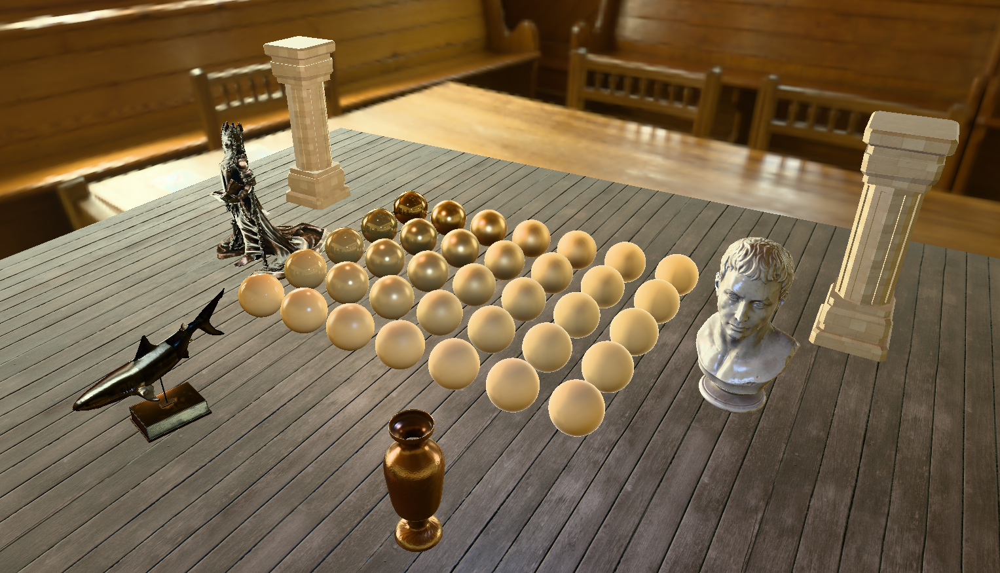
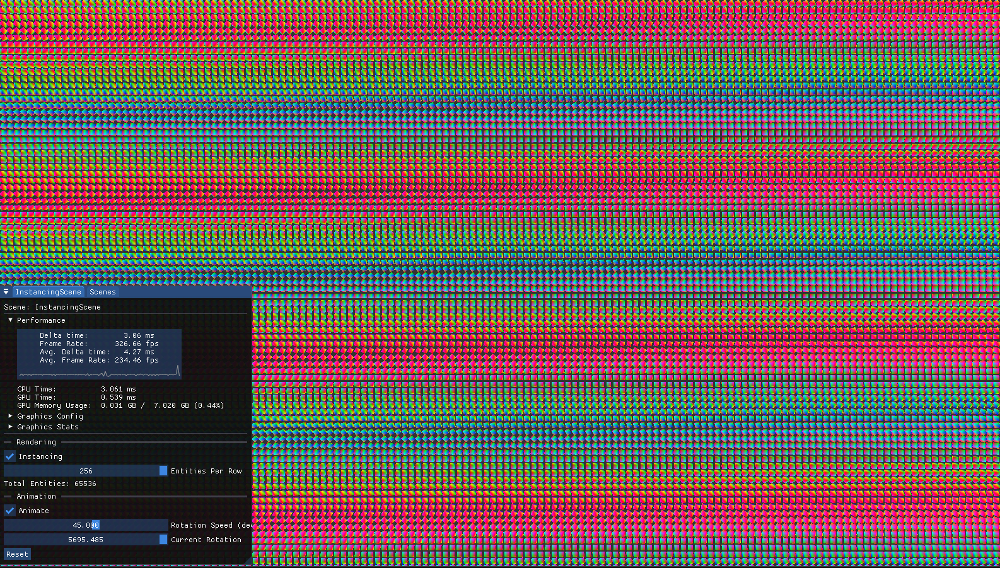
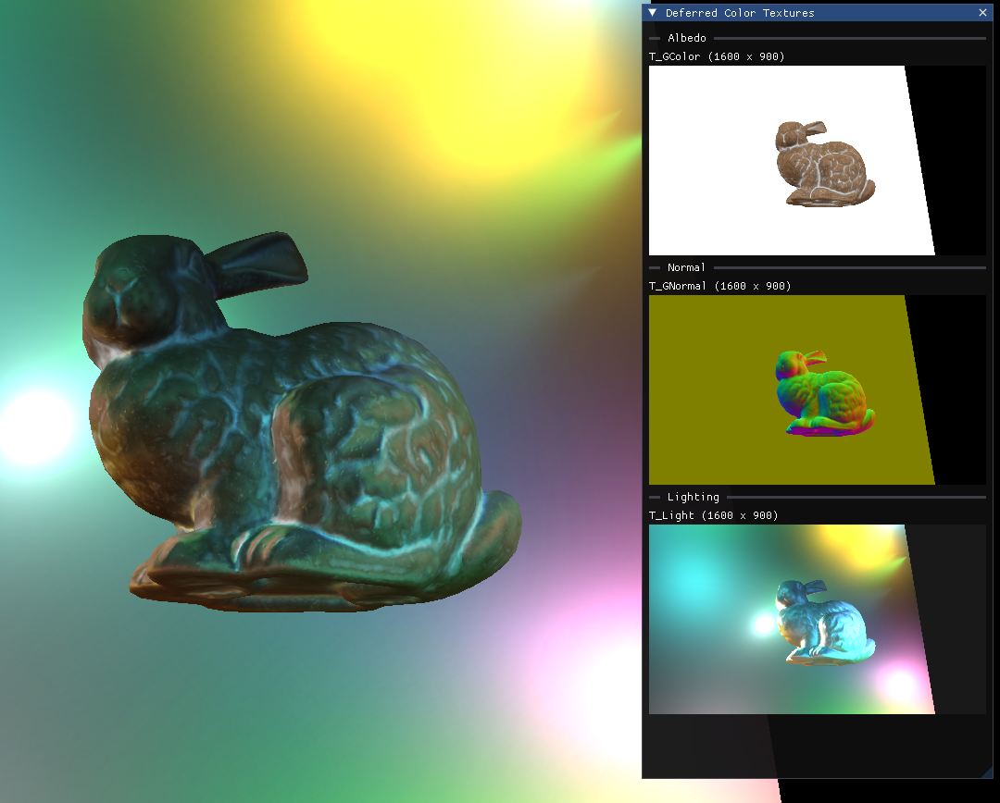
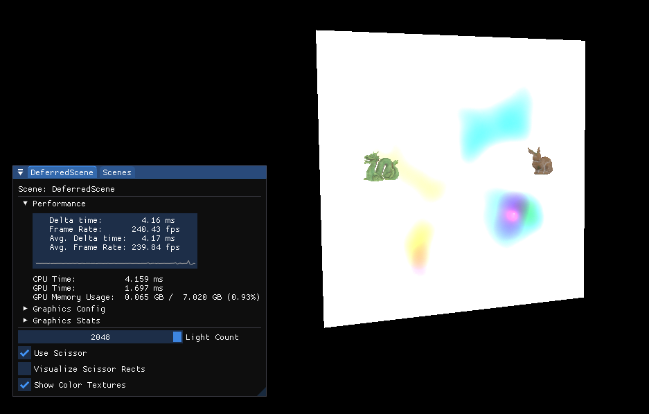
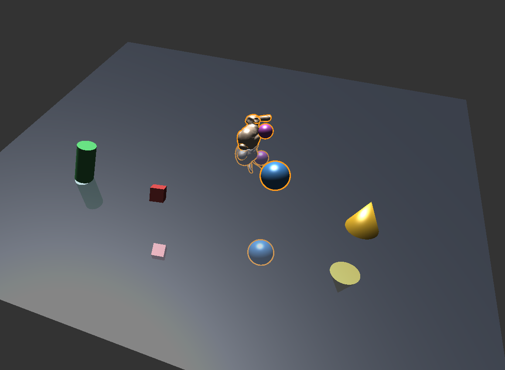
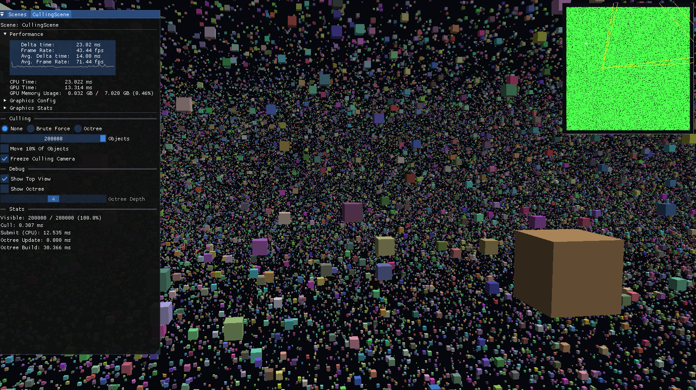
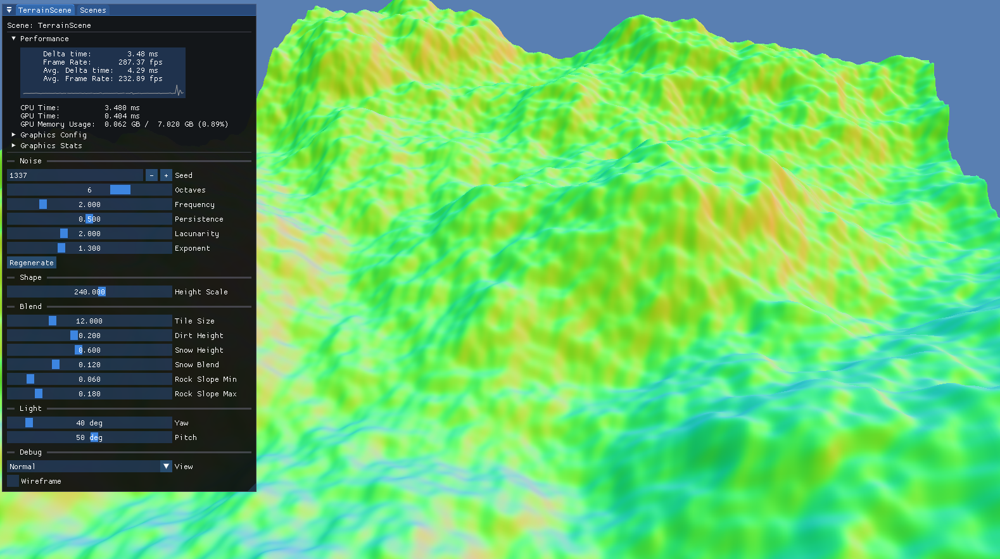
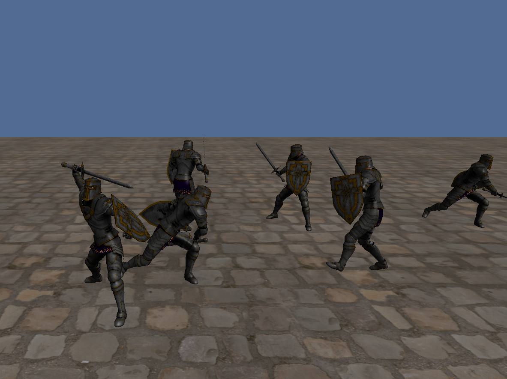
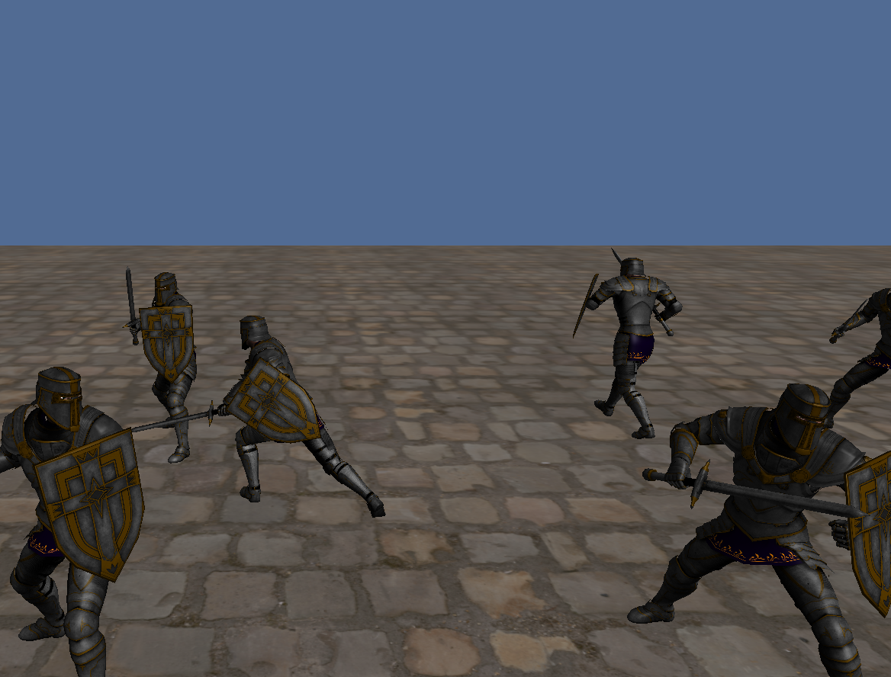

<h1 align="center">JamEngine</h1>

<p align="center">D3D11 기반 C++20 게임 엔진 프레임워크</p>

<p align="center">
  
  
  
  
</p>

<p align="center"></p>

## Contents

- [프로젝트 소개](#프로젝트-소개)
- [프레임워크 구성](#프레임워크-구성)
- [샘플](#샘플)
- [빌드 및 실행](#빌드-및-실행)

## 프로젝트 소개

부경대학교 캡스톤디자인 경진대회 출품을 위해 9개월간 개발한 D3D11 기반 C++20 게임 엔진 프레임워크입니다. 렌더링 구현에 중점을 두었고, `SandboxApp`에 그래픽스 기법을 적용한 샘플 씬을 담았습니다.

## 프레임워크 구성

### 애플리케이션과 씬

[`Application`](JamEngine/Application.h)은 창, 그래픽스, 입력과 선택한 하위 시스템을 초기화하고 메인 루프를 실행합니다. 한 프레임은 윈도우 이벤트 처리, 메인 스레드 명령 실행, `Update()`, `Render()`, ImGui 출력, 화면 표시, 입력 갱신 순서로 진행합니다. 파생 클래스는 `Init()`, `Update()`, `Render()`, `ImGuiRender()`, `OnEvent()`, `Shutdown()`을 재정의해 동작을 추가합니다.

하위 시스템과 그래픽스 설정은 초기화 플래그 하나로 지정합니다. `SceneManager`, `AssetManager`, `ImGuiEngine`을 켜고 끌 수 있고, 백버퍼 수(2~4개), HDR 포맷(RGB10A2, RGBA16 Float), MSAA(4·8·16배), 그래픽스 디버거 연결도 같은 플래그로 정합니다.

`Event`를 상속한 타입은 `EventDispatcher`로 받아 타입별 핸들러에 연결합니다. `Application::DispatchEvent()`는 이벤트를 애플리케이션, 윈도우, 그래픽스, `AssetManager`, `SceneManager`, 입력 순으로 전달합니다. 메인 스레드에서 실행해야 하는 작업은 `SubmitCommandToMainThread()`로 제출하면 다음 프레임 시작에 실행됩니다.

[`Scene`](JamEngine/Scene.h)은 진입·종료, 업데이트, 렌더링, ImGui, 이벤트, 크기 변경을 가상 함수로 구현합니다. `OnRender()`는 출력 프레임버퍼, 뷰포트, 카메라를 담은 `RenderView`를 받으므로, [`SceneManager`](JamEngine/SceneManager.h)는 같은 씬을 백버퍼에도 다른 프레임버퍼에도 그릴 수 있습니다.

`LoadScene()`은 기본적으로 씬 교체를 명령으로 제출해 다음 프레임 시작에 실행합니다. 그래서 실행 중인 `OnUpdate()` 안에서 씬이 사라지지 않습니다. 교체할 때는 이전 씬의 `OnExit()`, 새 씬의 `OnEnter()`, 화면 크기 적용, 참조가 끊긴 에셋 정리, `SceneChangedEvent` 전달 순서로 처리합니다. SandboxApp의 샘플 씬은 모두 이 인터페이스를 구현하므로, 씬이 달라도 애플리케이션 루프와 공통 시스템은 같습니다.

### 엔티티·컴포넌트와 자산

씬은 EnTT 레지스트리를 하나씩 소유하고, [`Entity`](JamEngine/Entity.h)가 레지스트리와 핸들을 묶어 컴포넌트 추가·조회를 맡습니다. 엔티티는 UID를 가지고, 씬이 UID로 엔티티를 찾습니다. UID를 지정해 엔티티를 만들 수 있어 같은 엔티티를 같은 UID로 다시 만들 수 있습니다.

루트 엔티티 아래에 부모·자식 관계와 로컬·월드 변환을 `SceneNode`로 관리하고, `UpdateSceneGraph()`는 변환이 바뀐 엔티티를 모아 둡니다. 모델은 노드 구조를 따라 엔티티 트리로 만들 수 있고, 엔티티 복제는 하위 트리까지 복제합니다.

컴포넌트 클래스에 `JAM_COMPONENT_BODY`를 쓰면 정적 변수가 [`ComponentDatabase`](JamEngine/ComponentDatabase.h)에 타입을 등록합니다. 데이터베이스는 타입마다 생성, 복사 생성, 제거, 조회, 보유 확인 함수를 보관합니다. 컴포넌트에 `Serializable`, `Editable`, `NonRemoveable`, `NonCreatableOnEditor` 속성을 적으면 해당하는 직렬화·에디터 함수도 함께 등록하고, 속성만 적고 필요한 멤버 함수가 없으면 컴파일 단계에서 오류가 납니다. 엔티티 복제는 이 데이터베이스를 순회해 컴포넌트를 복사하므로, 새 컴포넌트를 추가해도 복제 코드는 고치지 않습니다.

[`AssetManager`](JamEngine/AssetManager.h)는 텍스처, 재질, 메시, 모델을 종류와 경로로 캐시하고 `Ref`로 공유합니다. 같은 경로를 다시 요청하면 캐시를 돌려주고, 강제 재로드도 지정할 수 있습니다. 로드 결과는 `Expect`로 돌려주어 실패를 값으로 처리합니다. 파일 수정 이벤트가 오면 이미 불러온 에셋을 같은 객체에서 다시 읽으므로, 그 에셋을 참조하는 쪽은 바뀐 내용을 그대로 씁니다. 참조 수가 1인, 관리자만 가진 에셋은 `CleanGarbage()`로 제거하며 씬을 교체할 때 호출합니다.

### 그래픽스와 렌더링 패스

[`Graphics`](JamEngine/Graphics.h)는 D3D11 백엔드입니다. 버퍼, 텍스처, 셰이더, 프로그램, 프레임버퍼를 포인터 대신 핸들로 다룹니다. 핸들은 32비트 값에 24비트 인덱스와 8비트 토큰을 담습니다. 리소스를 해제하면 슬롯의 토큰을 올리므로, 해제한 핸들로 접근하면 토큰이 달라 유효성 검사에서 걸립니다.

파이프라인 상태는 설정할 때 바로 적용하지 않고 바뀐 것만 기록합니다. 상태 종류는 `ePipelineDirtyFlags`로 구분하고, 상수 버퍼, 셰이더 리소스, 샘플러 같은 슬롯 배열은 바뀐 슬롯의 범위(`dirtyBegin`, `dirtyEnd`)를 추적합니다. 드로우(`Submit`)와 `Dispatch`를 제출할 때 바뀐 종류만, 바뀐 슬롯 범위만 D3D11 `Set*` 호출로 넘깁니다.

[`RenderGraph`](JamEngine/RenderGraph.h)는 렌더, 컴퓨트, 유틸리티 패스를 이름으로 등록하고, 텍스처와 버퍼 같은 리소스도 이름으로 참조합니다. 패스는 프레임버퍼, 셰이더 프로그램, 렌더 상태, 읽는 리소스, 상수 버퍼와 실행 함수를 선언하고, 실행 함수가 드로우를 제출합니다. 아래는 [`DeferredScene`](SandboxApp/DeferredScene.cpp)의 조명 패스입니다.

```cpp
m_graph.AddRenderPass("Pass_Light")
    .SetFrameBuffer("FB_Light")
    .SetProgram("P_Light")
    .SetRenderTargetClearCommand(RGBA::FromLinear(0.1f, 0.1f, 0.1f), 0)   // ambient
    .SetRenderFlags(kBackCull | eRenderFlags::Scissor)
    .SetBlendFlags(kAdditiveBlend, 0)
    .SetTexture("T_GColor", eShader::PixelShader, kColorSlot)
    .SetTexture("T_GNormal", eShader::PixelShader, kNormalSceneSlot)
    .SetTexture("T_GDepth", eShader::PixelShader, kDepthSlot)
    .SetConstantBuffer("CB_Camera", eShader::VertexShader, CBCamera::kSlot)
    .SetConstantBuffer("CB_Camera", eShader::PixelShader, CBCamera::kSlot)
    .SetConstantBuffer("CB_Light", eShader::PixelShader, CBLight::kSlot)
    .SetExecutor(Bind<&DeferredScene::SubmitLights_>(this));
```

그래프는 처음 실행할 때, 그리고 패스나 리소스를 바꾼 뒤에 컴파일합니다. 컴파일은 세 가지를 처리합니다.

* 불필요한 패스 제거: 패스가 읽고 쓰는 리소스 이름으로 의존 관계를 만들고, 최종 패스와 부수 효과 패스에서 거슬러 올라가 도달하지 못하는 패스를 실행 목록에서 뺍니다. 패스를 끄면 그 결과만 쓰던 앞 단계도 함께 빠집니다.
* 리소스 충돌 해소: 한 패스가 렌더 타깃이나 UAV로 쓰는 리소스를 다른 패스가 셰이더 리소스로 읽을 때처럼 바인딩이 겹치는 경우를 찾아, 패스 시작 전에 풀어야 할 슬롯 목록을 만듭니다. 마지막 패스의 상태가 다음 프레임의 첫 패스와 겹칠 수 있어 패스 목록을 두 번 훑습니다.
* 바인딩 생략: 앞 패스에서 같은 슬롯에 같은 리소스, 상수 버퍼, 샘플러가 이미 바인딩되어 있으면 바인드 명령을 만들지 않습니다.

패스는 등록한 순서대로 실행합니다. 창 크기가 바뀌면 크기에 비례해 만든 텍스처와 프레임버퍼만 다시 만들고, 패스 구조는 그대로 두어 재컴파일 없이 바인딩의 핸들 값만 갱신합니다. 샘플의 디퍼드 조명, 섀도 매핑, SSAO, SSR처럼 앞 단계의 결과를 다음 단계에서 읽는 작업이 이 그래프로 연결되어 있습니다.

## 샘플

### SimpleScene

기본적인 렌더링 테스트입니다. 스탠포드 버니 모델과 큐브, 구를 렌더링합니다.
모델의 정점에 월드·뷰·투영 변환을 적용하고, 표면의 노멀을 이용해 조명을 계산합니다.


### InstancingScene

같은 큐브를 반복해서 렌더링하며 인스턴싱 사용 여부에 따른 성능을 비교합니다.
일반 렌더링은 큐브마다 변환 행렬을 갱신하고 드로우콜을 호출합니다.
인스턴싱은 각 큐브의 변환 행렬을 인스턴스 버퍼에 모아 한 번의 드로우콜로 처리하므로, CPU의 반복적인 제출 비용을 줄일 수 있습니다.



큐브 65,536개 기준 인스턴싱 미사용 시 190–210 FPS, 사용 시 550–600 FPS입니다.
각 범위의 중간값으로 비교하면 200 FPS에서 575 FPS로 약 2.9배입니다.

### MultiVertexStreamScene

정점 속성을 여러 버텍스 버퍼로 나누어 전달하는 테스트입니다.
위치는 0번 슬롯, 색상은 1번 슬롯에 바인딩합니다.
입력 레이아웃에서 각 속성의 슬롯을 지정하면, 서로 다른 버퍼의 데이터를 하나의 정점 입력으로 사용할 수 있습니다.


### TextureScene

알베도, 노멀, AO 텍스처를 적용한 기본적인 텍스처 매핑 테스트입니다.
알베도는 표면의 색상을 정하고, 노멀 맵은 조명 계산에 사용하는 노멀을 바꿔 작은 굴곡을 표현합니다.
AO는 틈이나 접촉 부위처럼 빛이 덜 닿는 부분을 어둡게 표현합니다.

기둥과 동상 모델에 텍스처를 적용했습니다. 각 텍스처를 켜고 끄면서 표면의 색과 굴곡, 음영의 차이를 볼 수 있습니다.


### PBRScene

Metallic과 Roughness를 사용하는 물리 기반 렌더링 테스트입니다.
Metallic은 금속성에 따른 반사 특성을, Roughness는 표면의 거칠기에 따른 반사의 선명도를 조절합니다.
구와 모델에 서로 다른 재질을 적용해 그 차이를 표현했습니다.


IBL(Image-Based Lighting)을 적용해 주변 환경의 조명도 재질에 반영합니다.
확산광에는 Irradiance 맵을 사용하고, 정반사는 Roughness에 따라 필터링된 환경맵과 BRDF LUT로 근사합니다.
아래 사진처럼 환경이 바뀌면 같은 모델에서도 반사되는 색과 밝기가 달라집니다.

<table width="100%">
  <thead>
    <tr>
      <th align="center">밝은 환경광</th>
      <th align="center">따뜻한 환경광</th>
    </tr>
  </thead>
  <tbody>
    <tr>
      <td align="center"></td>
      <td align="center"></td>
    </tr>
  </tbody>
</table>

Studio, Courtyard, Church 환경을 선택할 수 있으며, 배경 표시도 따로 조절할 수 있습니다.

### DeferredScene

표면의 색상과 노멀, 깊이를 먼저 저장하고, 저장한 정보를 이용해 조명을 계산하는 디퍼드 렌더링 테스트입니다.
Scissor Rect를 이용해 각 광원의 영향 범위를 둘러싼 화면 영역에서만 픽셀을 처리하도록 최적화했습니다.
광원의 영향이 화면 일부에만 미칠 때 불필요한 조명 계산을 줄일 수 있습니다.

<table width="100%">
  <thead>
    <tr>
      <th align="center">다수의 점광원</th>
      <th align="center">Scissor Rect 시각화</th>
    </tr>
  </thead>
  <tbody>
    <tr>
      <td align="center"></td>
      <td align="center"></td>
    </tr>
  </tbody>
</table>

왼쪽은 점광원 512개의 조명 결과이고, 오른쪽은 점광원 26개의 Scissor Rect를 표시한 화면입니다.
색 사각형은 각 광원의 픽셀 처리 범위를 나타냅니다. Albedo, Normal, Lighting 버퍼도 ImGui에서 따로 볼 수 있습니다.

<table width="100%">
  <thead>
    <tr>
      <th align="center">컬러 버퍼 시각화</th>
      <th align="center">점광원 2,048개 렌더링</th>
    </tr>
  </thead>
  <tbody>
    <tr>
      <td align="center"></td>
      <td align="center"></td>
    </tr>
  </tbody>
</table>

점광원 2,048개에 Scissor Rect를 적용한 상태에서 약 240 FPS를 유지했습니다.

### ShadowScene

광원에서 바라본 깊이를 저장한 뒤, 표면의 깊이와 비교하는 섀도 매핑을 구현했습니다.
광원과 해당 표면 사이에 다른 물체가 있으면 해당 위치를 그림자로 처리합니다.

<table width="100%">
  <thead>
    <tr>
      <th align="center">기둥과 동상의 그림자</th>
      <th align="center">모델 주변의 그림자 경계</th>
    </tr>
  </thead>
  <tbody>
    <tr>
      <td align="center"></td>
      <td align="center"></td>
    </tr>
  </tbody>
</table>

점광원에는 여섯 방향의 깊이를 2D 텍스처 배열에 저장하는 Omni Shadow Mapping을 사용합니다.
스팟라이트는 광원 시점의 깊이를 한 장 저장합니다.
방향광에는 카메라의 가시 거리를 네 구간으로 나누는 Cascaded Shadow Mapping을 사용해 가까운 영역에 더 많은 해상도를 배분합니다.

Hard는 깊이를 한 번 비교하고, PCF는 주변의 비교 결과를 평균내어 경계를 부드럽게 만듭니다. PCF는 3×3, 5×5, 7×7을 지원합니다.
VSM은 깊이와 깊이의 제곱을 저장하고, 두 값으로 구한 분산을 이용해 그림자를 근사합니다.
광원 종류, 필터, 섀도 맵 해상도를 바꾸며 결과를 비교할 수 있습니다.

### StencilScene

스텐실 버퍼를 이용한 평면 반사와 아웃라인 테스트입니다.
스텐실에 기록한 값을 조건으로 사용해 오브젝트가 그려지는 영역을 제한합니다.

<table width="100%">
  <thead>
    <tr>
      <th align="center">평면 반사와 아웃라인</th>
      <th align="center">모델의 외곽선</th>
    </tr>
  </thead>
  <tbody>
    <tr>
      <td align="center"></td>
      <td align="center"></td>
    </tr>
  </tbody>
</table>

평면 반사는 y=0 기준의 반사 행렬로 오브젝트를 한 번 더 렌더링합니다.
거울 영역에 스텐실을 기록해 반사된 오브젝트가 그 안에서만 보이도록 합니다.

아웃라인은 원래 오브젝트를 그리며 스텐실에 1을 기록합니다.
이후 정점을 노멀 방향으로 밀어 확장한 모델을 그리되, 스텐실이 1인 부분은 제외합니다.
원래 모델의 바깥으로 나온 부분만 남아 외곽선이 됩니다.

### CullingScene

옥트리 기반 프러스텀 컬링 테스트입니다.
오브젝트를 공간별로 나누어 저장하고, 옥트리 노드의 영역을 카메라 프러스텀과 비교합니다.
노드가 프러스텀 밖에 있으면 그 안의 오브젝트를 한꺼번에 제외할 수 있어, 모든 오브젝트를 하나씩 검사하는 비용을 줄입니다.


박스는 옥트리의 공간 분할을 나타냅니다. 탑뷰에서는 카메라 프러스텀과 오브젝트의 분포를 함께 볼 수 있습니다.

오브젝트 20만 개를 대상으로 컬링 미사용, 선형 검사, 옥트리를 비교했습니다.
아래 평균 FPS는 각 측정 화면의 Avg. Frame Rate 값입니다.

<table width="100%">
  <thead>
    <tr>
      <th align="center">컬링 미사용</th>
      <th align="center">선형 검사</th>
      <th align="center">옥트리</th>
    </tr>
  </thead>
  <tbody>
    <tr>
      <td align="center"></td>
      <td align="center"></td>
      <td align="center"></td>
    </tr>
    <tr>
      <td align="center">71.44 FPS</td>
      <td align="center">86.92 FPS</td>
      <td align="center">97.20 FPS</td>
    </tr>
  </tbody>
</table>

옥트리를 적용하면 미사용 71.44 FPS에서 97.20 FPS(약 1.36배)로, 선형 검사 86.92 FPS에서 97.20 FPS(약 1.12배)로 올랐습니다.

### TerrainScene

Perlin Noise를 여러 옥타브로 합쳐 지형을 생성합니다.
CPU에서 높이맵을 만들고, 버텍스 셰이더에서 높이를 읽어 격자 정점을 위아래로 이동시킵니다.


인접한 높이의 차이로 노멀을 계산해 지형의 경사에 맞게 조명을 적용합니다.
높이와 경사에 따라 풀, 바위, 눈, 흙 텍스처를 섞습니다.
높이와 노멀을 따로 표시하면 지형의 형태와 조명에 사용하는 데이터를 살펴볼 수 있습니다.

<table width="100%">
  <thead>
    <tr>
      <th align="center">높이 시각화</th>
      <th align="center">노멀 시각화</th>
    </tr>
  </thead>
  <tbody>
    <tr>
      <td align="center"></td>
      <td align="center"></td>
    </tr>
  </tbody>
</table>

### SSAOScene

깊이와 노멀 버퍼로 주변광 차폐를 계산하는 SSAO(Screen Space Ambient Occlusion) 테스트입니다.
주변 표면에 의해 빛이 덜 닿는 부분을 어둡게 만들어 틈과 접촉 부위의 음영을 표현합니다.

<table width="100%">
  <thead>
    <tr>
      <th align="center">최종 장면</th>
      <th align="center">AO 결과</th>
    </tr>
  </thead>
  <tbody>
    <tr>
      <td align="center"></td>
      <td align="center"></td>
    </tr>
  </tbody>
</table>

깊이에서 현재 픽셀의 뷰 공간 위치를 복원하고, 노멀 방향의 반구 안에 샘플을 배치합니다.
샘플을 화면에 투영해 깊이와 비교하며 주변 표면에 가려지는 정도를 구합니다.
노이즈 텍스처로 샘플 방향을 회전시키고 블러로 결과를 정리한 뒤, 최종 조명의 주변광에만 적용합니다.

### SSRScene

화면에 렌더링한 정보를 이용해 반사를 만드는 SSR(Screen Space Reflection) 테스트입니다.
반사 표면에서 레이를 진행시키며 깊이 버퍼와 교차하는 위치를 찾고, 해당 위치의 색상을 반사색으로 사용합니다.

<table width="100%">
  <thead>
    <tr>
      <th align="center">바닥과 구의 반사</th>
      <th align="center">다른 시점의 반사</th>
    </tr>
  </thead>
  <tbody>
    <tr>
      <td align="center"></td>
      <td align="center"></td>
    </tr>
  </tbody>
</table>

교차 후보의 표면 방향을 검사하고, 색상을 섞을 때 깊이와 노멀을 함께 확인해 다른 물체의 색이 섞이는 현상을 줄입니다.
화면 가장자리와 교차가 불확실한 부분에서는 반사를 약하게 처리합니다.

화면 밖이나 다른 물체 뒤에 가려진 정보는 사용할 수 없다는 한계가 있습니다.
Fallback을 켜면 반사를 찾지 못한 부분을 하늘·지면 방향에 따라 계산한 배경색으로 채웁니다.

### ParticleScene

컴퓨트 셰이더를 이용한 GPU 파티클 테스트입니다.
RWStructuredBuffer에 파티클의 위치, 속도, 회전, 수명을 저장하고 GPU에서 병렬로 갱신합니다.
버텍스 셰이더가 같은 버퍼를 읽어 렌더링하므로 시뮬레이션 결과를 CPU로 가져올 필요가 없습니다.

<table width="100%">
  <thead>
    <tr>
      <th align="center">눈</th>
      <th align="center">색종이</th>
    </tr>
  </thead>
  <tbody>
    <tr>
      <td align="center"></td>
      <td align="center"></td>
    </tr>
  </tbody>
</table>

파티클 하나는 두 삼각형으로 만든 사각형이며, 전체 파티클을 인스턴싱으로 렌더링합니다.
정점 번호로 사각형의 모양을 만들고, 인스턴스 번호로 해당 파티클의 데이터를 읽습니다.
파티클 개수가 바뀌면 CPU에서 간접 드로우 인자를 갱신하고, DrawInstancedIndirect 한 번으로 제출합니다.

파티클 10만 개에서 약 2,400 FPS입니다.

### MousePickingScene

오브젝트 ID 버퍼를 이용한 마우스 피킹 테스트입니다.
색상과 ID를 서로 다른 렌더 타깃에 동시에 기록하고, 클릭한 위치의 ID 한 픽셀만 CPU로 읽어 선택합니다.
ID는 R32_UInt 형식으로 저장하며, 배경과 바닥의 ID는 0으로 두어 클릭 시 선택이 해제되도록 합니다.

<table width="100%">
  <thead>
    <tr>
      <th align="center">오브젝트 ID 시각화</th>
      <th align="center">선택한 오브젝트의 아웃라인</th>
    </tr>
  </thead>
  <tbody>
    <tr>
      <td align="center"></td>
      <td align="center"></td>
    </tr>
  </tbody>
</table>

아웃라인은 후처리에서 ID 버퍼를 읽어 그립니다.
선택된 ID의 픽셀 중 주변에 다른 ID가 있는 픽셀을 금색으로 칠하므로, 외곽선은 물체의 안쪽 경계에 생깁니다.
주변 픽셀의 검사 범위로 선의 두께를 조절합니다.

### SkinningScene

선형 블렌딩 스키닝을 이용한 캐릭터 애니메이션 테스트입니다.
Idle, Walk, Slash를 재생하고, 상태가 바뀔 때 이전 자세와 새 자세를 블렌딩해 자연스럽게 연결합니다.

<table width="100%">
  <thead>
    <tr>
      <th align="center">캐릭터 애니메이션</th>
      <th align="center">자세에 따른 메시 변형</th>
    </tr>
  </thead>
  <tbody>
    <tr>
      <td align="center"></td>
      <td align="center"></td>
    </tr>
  </tbody>
</table>

CPU에서 조인트별 스키닝 행렬을 계산해 상수버퍼로 전달합니다.
버텍스 셰이더에서는 정점마다 저장된 조인트 번호와 가중치로 행렬을 섞어 메시를 변형합니다.
WASD로 이동하고 Space로 Slash를 재생합니다.

## 빌드 및 실행

Windows x64에서 C++20으로 빌드합니다. Visual Studio 2026의 "C++를 사용한 데스크톱 개발" 워크로드가 필요하고, 프로젝트 도구 집합은 `v145`입니다. entt, fmt, DirectXTex, unordered_dense는 저장소에 포함되어 있지 않으며, 프로젝트 파일이 vcpkg 설정(`Vcpkg` 속성)을 사용합니다.

1. 저장소를 받습니다.

   ```powershell
   git clone https://github.com/JuggernautSensei/JamEngine.git
   ```

2. `JamEngine.sln`을 Visual Studio로 열고 `SandboxApp`을 시작 프로젝트로 지정합니다.
3. 구성을 `x64`로 두고 빌드한 뒤 실행합니다. 명령줄에서는 `scripts/Build.ps1`로 빌드할 수 있습니다.

   ```powershell
   powershell -NoProfile -File scripts/Build.ps1 -Configuration Release
   ```

실행하면 ImGui의 Scenes 창에서 샘플 씬을 고를 수 있고, 카메라는 W, A, S, D, Q, E 키로 움직입니다.
