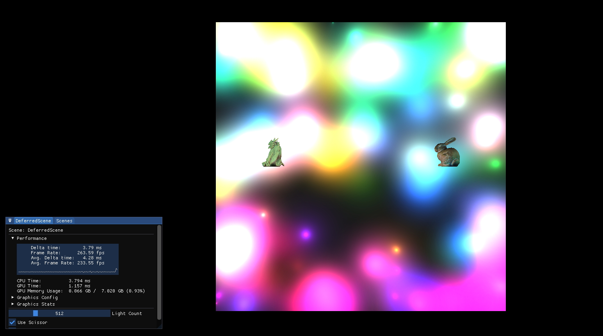
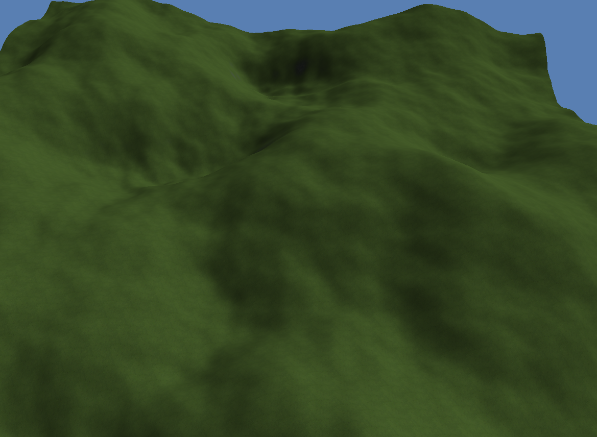
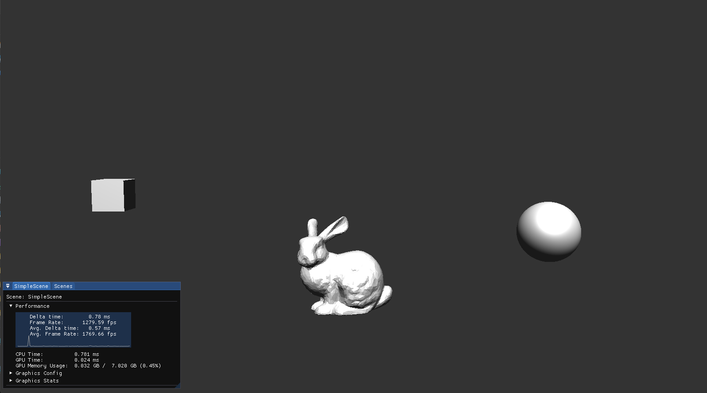

<h1 align="center">JamEngine</h1>

<p align="center">Direct3D 11 기반 C++20 게임 개발 프레임워크</p>

<p align="center">
  
  
  
  
</p>


## Contents

- [프로젝트 소개](#프로젝트-소개)
- [에디터 데모](#에디터-데모)
- [컴포넌트 리플렉션](#컴포넌트-리플렉션)
- [렌더 그래프](#렌더-그래프)
- [렌더링 샘플](#렌더링-샘플)
- [빌드 및 실행](#빌드-및-실행)

## 프로젝트 소개

부경대학교 캡스톤디자인 경진대회 출품을 위해 9개월간 개발한 게임 엔진 프레임워크입니다. 엔티티와 에셋을 관리하고 여러 렌더링 기법을 같은 엔진에서 구현할 수 있도록, 씬 관리와 Direct3D 11 렌더링을 정적 라이브러리 `JamEngine`에 묶었습니다. 현재 솔루션의 실행 프로젝트인 `SandboxApp`에서 PBR, 디퍼드 조명, GPU 파티클 등의 샘플을 선택할 수 있습니다.

| 구성 | 역할 |
| --- | --- |
| 애플리케이션 | 창과 하위 시스템 초기화, 메인 루프, 씬 전환을 관리합니다. [Application](JamEngine/Application.h) · [SceneManager](JamEngine/SceneManager.h) |
| 씬과 엔티티 | EnTT로 컴포넌트를 관리하고, 부모·자식 계층을 따라 로컬 변환과 월드 변환을 계산합니다. [Scene](JamEngine/Scene.h) · [Entity](JamEngine/Entity.h) |
| 에셋 | 경로로 모델, 메시, 재질, 텍스처를 관리하고 모델의 노드 구조를 엔티티 계층으로 옮깁니다. [AssetManager](JamEngine/AssetManager.h) |
| 그래픽스 | D3D11 자원을 핸들로 관리하고 드로우와 디스패치를 제출합니다. 렌더 그래프는 패스가 사용할 자원을 바인딩하고 해제합니다. [Graphics](JamEngine/Graphics.h) · [RenderGraph](JamEngine/RenderGraph.h) |

엔진에는 수학, 바운딩 볼륨, 옥트리, 파일 감시, JSON 아카이브, 메모리 풀도 포함됩니다. `JamTest`에서는 단위 테스트를, `JamBenchmark`에서는 수학·문자열·옥트리 등의 벤치마크를 실행합니다.

## 에디터 데모

아래 GIF는 개발 과정에서 제작한 ImGui 씬 에디터에서 엔티티를 편집하고, 에셋을 가져와 씬을 구성하고, 게임 화면에서 동작을 확인한 기록입니다.

### 엔티티 편집과 모델 임포트

계층 트리에서 엔티티를 만들거나 복제하고, 씬 뷰의 기즈모로 위치·회전·크기를 조절합니다. 인스펙터에서 렌더러블 컴포넌트를 추가해 사용할 메시와 재질을 지정합니다.


FBX를 임포트하면 엔진 형식의 모델·메시·재질 파일이 생성됩니다. 모델을 씬에 배치하면 원본 노드 구조대로 엔티티 계층이 생기고, 인스펙터에서 재질 슬롯에 지정한 텍스처가 씬 뷰에 반영됩니다.


### 씬 저장과 실행

씬 파일에서 엔티티 계층과 컴포넌트 값을 복원할 수 있습니다. Sponza 데모에서는 저장한 씬을 다시 열고 카메라 컴포넌트를 추가한 뒤, `Run`으로 카메라의 게임 화면을 확인합니다.


실행 모드에서는 엔티티에 붙인 게임 로직도 동작합니다. 큐브 데모는 방향키로 큐브를 움직인 뒤 `Edit`을 눌러 편집 시점으로 돌아가는 과정입니다.


## 컴포넌트 리플렉션

`ComponentDatabase`는 컴포넌트 타입별 생성·조회·복사 함수를 `Delegate` 테이블에 보관합니다. `JAM_COMPONENT_BODY`를 선언하면 정적 등록 객체가 이 테이블에 타입을 추가합니다. 엔티티 복제처럼 여러 컴포넌트를 공통으로 다루는 코드는 테이블을 순회해 원본이 가진 컴포넌트의 복사 함수를 호출합니다. 자식 엔티티도 재귀적으로 복제해 부모·자식 관계를 재구성합니다. [타입 등록](JamEngine/ComponentDatabase.h) · [엔티티 복제](JamEngine/Scene.cpp)

카메라, 렌더러블, 조명 등 각 컴포넌트는 필요한 기능을 플래그로 선언합니다. `Serializable`을 선언하면 `Serialize`와 `Deserialize`를, `Editable`을 선언하면 인스펙터가 호출할 `DrawEditPanel`을 등록합니다. 필요한 시그니처는 컴파일 단계에서 검증합니다. 아래 점광원은 두 플래그를 함께 쓰는 예입니다. [플래그 검증](JamEngine/ComponentMetadata.h)

```cpp
struct PointLightComponent
{
    JAM_COMPONENT_BODY(PointLightComponent);
    JAM_COMPONENT_DISPLAY_NAME("point light component");
    JAM_COMPONENT_PROPERTY_FLAGS(eComponentPropertyFlags::Serializable, eComponentPropertyFlags::Editable);

    void Serialize(ArchiveWriter& _writer, Scene* _pScene, Entity _owner) const;
    void Deserialize(ArchiveReader& _reader, Scene* _pScene, Entity _owner);
    void DrawEditPanel(Scene* _pScene, Entity _entity);

    Vec3  radiance     = Vec3::kZero;
    float intensity    = 1.0f;
    float fallOffStart = 1.0f;
    float fallOffEnd   = 10.0f;
};
```

[점광원 컴포넌트 원본](JamEngine/PointLightComponent.h)

## 렌더 그래프

D3D11에서는 텍스처를 렌더 타깃과 셰이더 입력에 동시에 바인딩할 수 없습니다. 여러 패스가 같은 자원을 번갈아 쓰는 씬에서 이 해제를 패스마다 관리하는 대신, `RenderGraph`에 각 패스가 읽고 쓰는 자원을 이름으로 선언했습니다. 예를 들어 SSAO 패스는 G-buffer의 법선과 깊이를 읽어 차폐 값을 기록합니다. 블러 패스가 차폐 값을 정리하면 합성 패스가 주변광에 반영합니다. [SSAO 패스 구성](SandboxApp/SSAOScene.cpp)

1. **필요한 패스를 찾습니다.** 최종 출력 패스와 부수 효과가 있다고 표시한 패스에서 시작해, 입력 자원을 만드는 패스를 역방향으로 따라갑니다. 이 탐색에서 도달하지 않은 패스는 실행 목록에서 제외합니다.
2. **바인딩 명령을 만듭니다.** 남은 패스를 등록 순서대로 따라가며 슬롯별 자원 상태를 추적합니다. 렌더 타깃을 읽기 전에 쓰기 바인딩을 해제하고, 읽던 자원에 쓰기 전에는 셰이더 입력에서 해제합니다. 같은 자원을 같은 슬롯에서 계속 읽으면 중복 바인딩을 생략합니다.
3. **프레임 경계의 충돌도 처리합니다.** 마지막 패스의 바인딩이 다음 프레임 첫 패스까지 이어지므로 두 번 순회하며 두 번째 순회의 해제 목록을 사용합니다.

프레임마다 준비된 명령을 실행하고, 패스 구성이 달라지면 그래프를 다시 컴파일합니다. 창 크기만 달라지면 자동 크기 조정 대상으로 지정한 텍스처와 프레임 버퍼를 재생성하고 핸들과 뷰포트를 갱신합니다. [렌더 그래프 구현](JamEngine/RenderGraph.cpp)

## 렌더링 샘플

`SandboxApp`의 Scenes 창에서 샘플을 선택할 수 있습니다. 각 샘플은 동일한 `Scene` 인터페이스를 사용합니다. [샘플 선택 화면 구현](SandboxApp/SandboxApp.cpp)

### PBRScene · 이미지 기반 조명

금속성과 거칠기를 사용하는 PBR 재질에 이미지 기반 조명(IBL)을 적용했습니다. 확산광은 이래디언스 맵에서 얻고, 정반사는 거칠기별 환경 맵과 BRDF LUT로 계산합니다. 두 그림은 같은 동상을 서로 다른 환경에서 렌더링한 결과입니다.

<p align="center">
  
  
</p>

### DeferredScene · 디퍼드 조명

G-buffer에 색상, 법선, 깊이를 기록하고 점광원의 조명을 더합니다. 광원의 영향 반경을 감싸는 상자를 화면에 투영해 Scissor Rect를 만들고, 그 안에서만 조명 셰이더를 실행합니다. 오른쪽 그림의 색 사각형이 광원별 처리 영역입니다. 점광원 2,048개를 켠 시연에서 약 240 FPS를 기록했습니다. [시연 결과](Samples/DeferredScene/images/benchmark-2048-lights.png)

<p align="center">
  
  
</p>

### ShadowScene · 그림자

점광원에는 여섯 방향의 깊이를 저장하는 옴니 섀도 맵을, 스팟라이트에는 단일 섀도 맵을 사용합니다. 방향광은 카메라의 깊이 범위를 네 구간으로 나눠 가까운 곳에 더 높은 그림자 해상도를 배정합니다. Hard, PCF, VSM 필터를 비교할 수 있습니다.


### SSAOScene · 화면 공간 주변광 차폐

깊이에서 뷰 공간 위치를 복원한 뒤, 표면 법선 쪽 반구의 샘플이 주변 표면에 얼마나 가려지는지 계산합니다. 그림은 계산한 차폐 값만 보여줍니다. 블러로 노이즈를 줄인 뒤 조명 합성에서 주변광에 적용합니다.


### SSRScene · 화면 공간 반사

화면 공간에서 반사 광선을 따라가며 깊이 버퍼와 교차하는 지점을 찾고, 그 위치의 장면 색을 반사색으로 사용합니다. 그림에서는 바닥과 구 표면에 반사가 보입니다.


### InstancingScene · 인스턴싱

큐브 65,536개의 변환 행렬을 인스턴스 버퍼에 담아 드로우 호출 한 번으로 그립니다. 기존 시연에서는 큐브마다 그리는 방식이 190~210 FPS, 인스턴싱이 550~600 FPS였습니다.


### CullingScene · 옥트리 프러스텀 컬링

오브젝트 20만 개를 옥트리에 넣고, 카메라 프러스텀 밖에 있는 노드는 통째로 건너뜁니다. 아래 표는 컬링을 생략한 경우와 각 오브젝트를 선형으로 검사한 경우까지 비교한 결과입니다.


| 컬링 방식 | 평균 FPS | 프레임 시간 환산 |
| --- | ---: | ---: |
| 컬링 없음 | 71.44 | 14.0 ms |
| 오브젝트별 선형 검사 | 86.92 | 11.5 ms |
| 옥트리 | 97.20 | 10.3 ms |

### ParticleScene · GPU 파티클

컴퓨트 셰이더가 구조화 버퍼의 파티클 위치·속도·회전·수명을 갱신합니다. 정점 셰이더는 같은 버퍼를 읽고, CPU로 파티클 상태를 복사할 필요 없이 `DrawInstancedIndirect` 한 번으로 그립니다. 기존 측정에서 파티클 10만 개를 그릴 때 약 2,400 FPS를 기록했습니다.


### MousePickingScene · 마우스 선택과 아웃라인

장면 색과 오브젝트 ID(`R32_UINT`)를 별도 렌더 타깃에 기록합니다. 클릭 위치의 ID 한 픽셀을 읽어 오브젝트를 선택하고, 후처리에서 선택된 ID와 다른 ID가 맞닿는 경계를 칠합니다.


### SkinningScene · 캐릭터 애니메이션

선형 블렌딩 스키닝으로 캐릭터 메시를 변형하고, 대기·이동·공격처럼 동작이 바뀔 때는 이전 자세와 새 자세를 블렌딩합니다.


### TerrainScene · 지형

Perlin Noise로 높이맵을 만들고 표면의 높이와 경사에 따라 지형 텍스처를 섞습니다.



### StencilScene · 평면 반사와 외곽선

스텐실 버퍼로 평면 반사의 범위를 제한하고 오브젝트의 외곽선을 그립니다.


### TextureScene · 텍스처 매핑

알베도, 노멀, AO 텍스처를 적용해 표면의 색, 요철, 주변광 차폐를 표현합니다.


### MultiVertexStreamScene · 정점 스트림

위치와 색상 데이터를 별도의 정점 버퍼 슬롯에서 읽습니다.


### SimpleScene · 모델 렌더링

모델을 불러와 씬에 배치하고 표면 법선에 따라 조명을 계산합니다.



## 빌드 및 실행

Windows x64에서 Visual Studio 2026의 C++ 데스크톱 개발 워크로드와 플랫폼 도구 집합 `v145`를 사용합니다.

1. 저장소를 받습니다.

   ```powershell
   git clone https://github.com/JuggernautSensei/JamEngine.git
   ```

2. `JamEngine.sln`을 열고 `Release | x64`를 선택합니다. EnTT, unordered_dense 등 외부 헤더와 DirectXTex, Assimp, fmt 등 외부 라이브러리를 준비해 해당 경로를 Visual Studio의 VC++ 디렉터리에 추가합니다. 링크에 사용할 라이브러리 목록과 파일 이름은 공통 빌드 설정에서 확인할 수 있습니다. [공통 링크 설정](Directory.Build.targets)
3. `SandboxApp`을 시작 프로젝트로 지정하고 빌드한 뒤 실행합니다. 앱이 열리면 **Scenes** 창에서 샘플을 고릅니다. 자유 카메라가 있는 샘플에서는 W·A·S·D·Q·E로 이동하고 마우스 오른쪽 버튼을 누른 채 드래그해 시점을 돌립니다.

솔루션 전체를 명령줄에서 빌드하려면 저장소 루트에서 다음 명령을 실행합니다. 이 빌드에는 `JamTest`와 `JamBenchmark`의 의존성도 필요합니다.

```powershell
powershell -NoProfile -File scripts/Build.ps1 -Configuration Release
```
