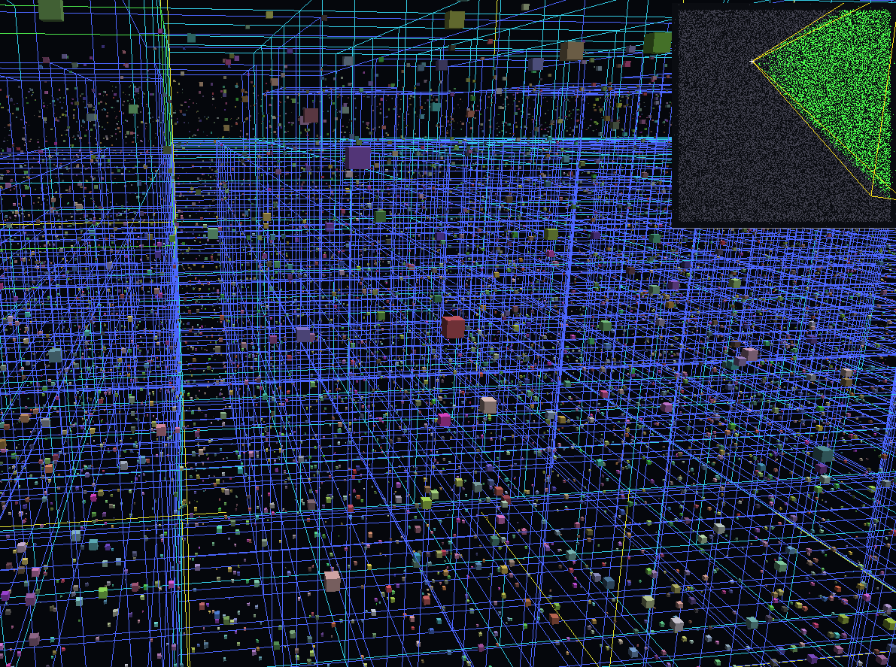
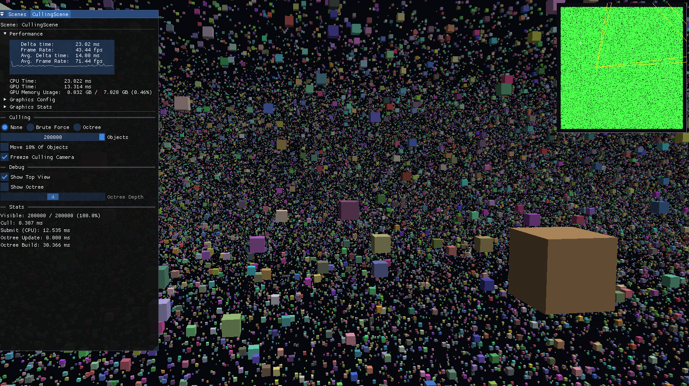
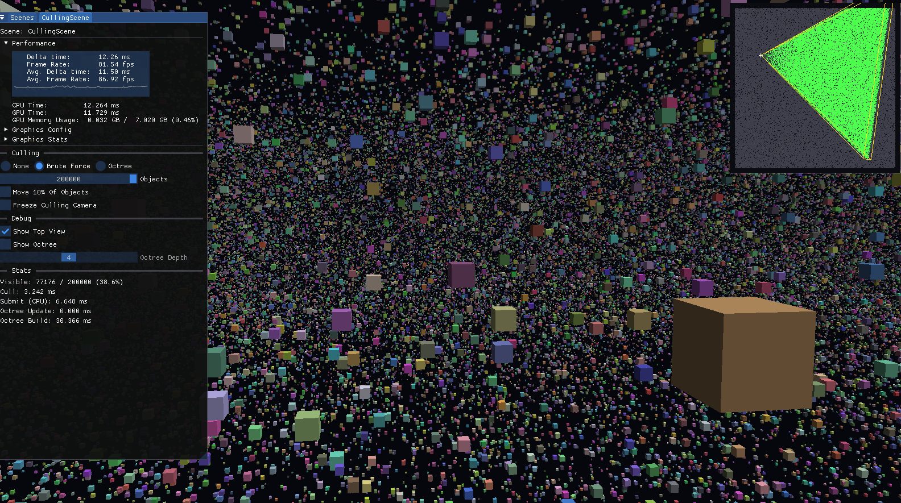

# CullingScene

옥트리 기반 프러스텀 컬링 테스트입니다.
오브젝트를 공간별로 나누어 저장하고, 옥트리 노드의 영역을 카메라 프러스텀과 비교합니다.
노드가 프러스텀 밖에 있으면 그 안의 오브젝트를 한꺼번에 제외할 수 있어, 모든 오브젝트를 하나씩 검사하는 비용을 줄입니다.

박스는 옥트리의 공간 분할을 나타냅니다. 탑뷰에서는 카메라 프러스텀과 오브젝트의 분포를 함께 볼 수 있습니다.

오브젝트 20만 개를 대상으로 컬링 미사용, 선형 검사, 옥트리를 비교했습니다.
아래 평균 FPS는 각 측정 화면의 Avg. Frame Rate 값입니다.

| 컬링 미사용 | 선형 검사 | 옥트리 |
|:---:|:---:|:---:|
|  |  |  |
| **71.44 FPS** | **86.92 FPS** | **97.20 FPS** |

옥트리 적용 시 미사용 대비 약 36.1%, 선형 검사 대비 약 11.8%의 FPS 향상이 나타났습니다.

성능 수치는 개발자 PC 기준입니다.
