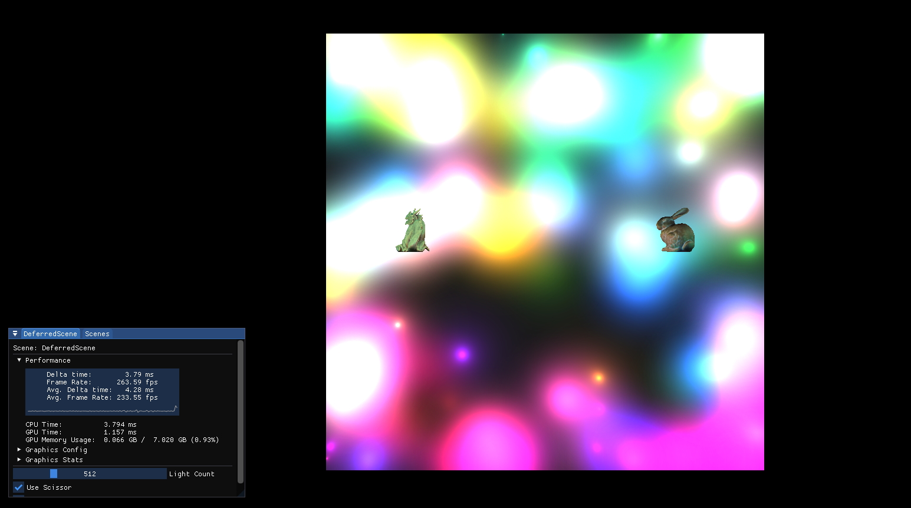
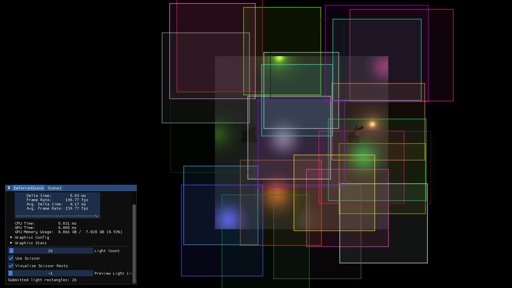

# DeferredScene

표면의 색상과 노멀, 깊이를 먼저 저장하고, 저장한 정보를 이용해 조명을 계산하는 디퍼드 렌더링 테스트입니다.
Scissor Rect를 이용해 각 광원의 영향 범위를 둘러싼 화면 영역에서만 픽셀을 처리하도록 최적화했습니다.
광원의 영향이 화면 일부에만 미칠 때 불필요한 조명 계산을 줄일 수 있습니다.

| 다수의 점광원 | Scissor Rect 시각화 |
|:---:|:---:|
|  |  |

왼쪽은 점광원 512개의 조명 결과이고, 오른쪽은 점광원 26개의 Scissor Rect를 표시한 화면입니다.
색 사각형은 각 광원의 픽셀 처리 범위를 나타냅니다. Albedo, Normal, Lighting 버퍼도 ImGui에서 따로 볼 수 있습니다.
