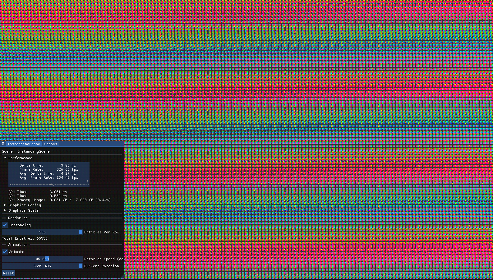

# InstancingScene

같은 큐브를 반복해서 렌더링하며 인스턴싱 사용 여부에 따른 성능을 비교합니다.
일반 렌더링은 큐브마다 변환 행렬을 갱신하고 드로우콜을 호출합니다.
인스턴싱은 각 큐브의 변환 행렬을 인스턴스 버퍼에 모아 한 번의 드로우콜로 처리하므로, CPU의 반복적인 제출 비용을 줄일 수 있습니다.

큐브 65,536개 기준 인스턴싱 사용 시 550–600 FPS, 미사용 시 190–210 FPS입니다.
각 범위의 중간값으로 비교하면 약 187.5%의 FPS 향상입니다.

성능 수치는 개발자 PC 기준입니다.
