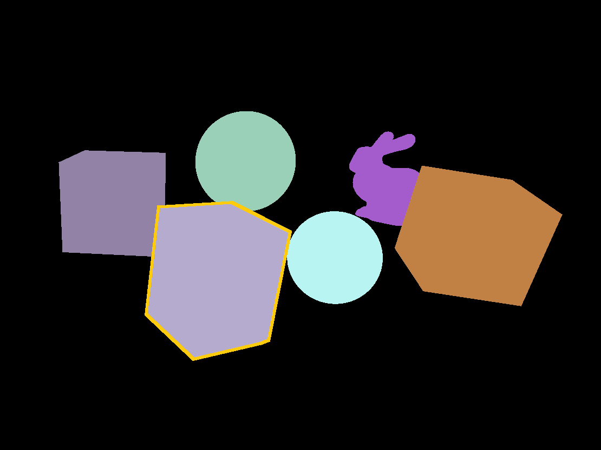
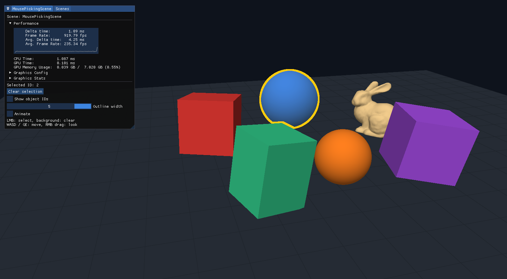

# MousePickingScene

오브젝트 ID 버퍼를 이용한 마우스 피킹 테스트입니다.
색상과 ID를 서로 다른 렌더 타깃에 동시에 기록하고, 클릭한 위치의 ID 한 픽셀만 CPU로 읽어 선택합니다.
ID는 R32_UInt 형식으로 저장하며, 배경과 바닥의 ID는 0으로 두어 클릭 시 선택이 해제되도록 합니다.

| 오브젝트 ID 시각화 | 선택한 오브젝트의 아웃라인 |
|:---:|:---:|
|  |  |

아웃라인은 후처리에서 ID 버퍼를 읽어 그립니다.
선택된 ID의 픽셀 중 주변에 다른 ID가 있는 픽셀을 금색으로 칠하므로, 외곽선은 물체의 안쪽 경계에 생깁니다.
주변 픽셀의 검사 범위로 선의 두께를 조절합니다.
