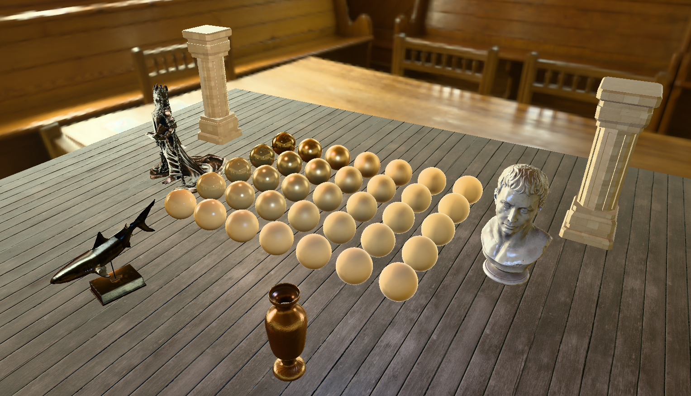
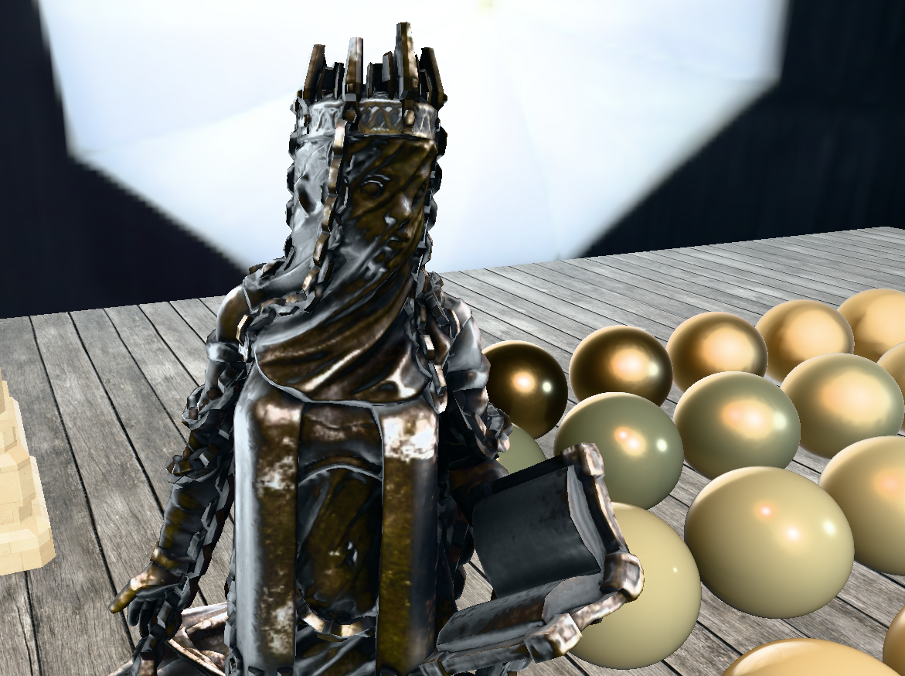
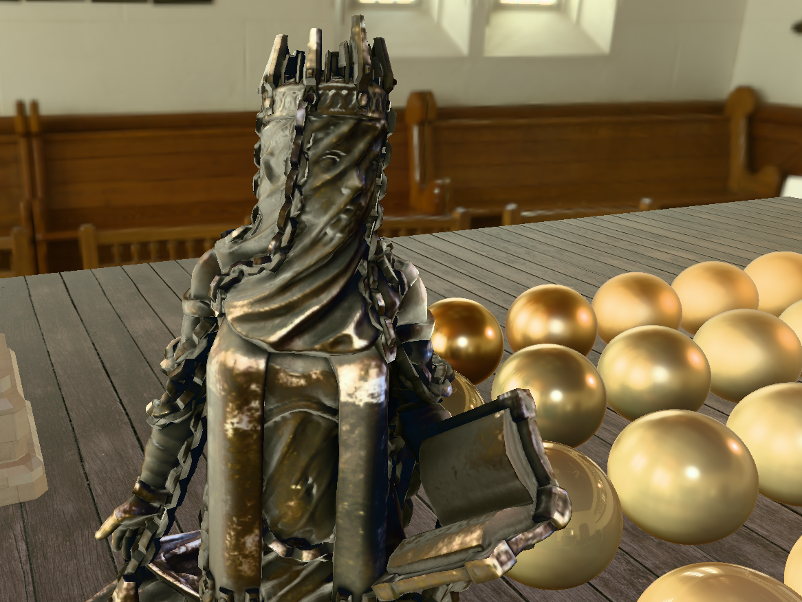

# PBRScene

Metallic과 Roughness를 사용하는 물리 기반 렌더링 테스트입니다.
Metallic은 금속성에 따른 반사 특성을, Roughness는 표면의 거칠기에 따른 반사의 선명도를 조절합니다.
구와 모델에 서로 다른 재질을 적용해 그 차이를 표현했습니다.

IBL(Image-Based Lighting)을 적용해 주변 환경의 조명도 재질에 반영합니다.
확산광에는 Irradiance 맵을 사용하고, 정반사는 Roughness에 따라 필터링된 환경맵과 BRDF LUT로 근사합니다.
아래 사진처럼 환경이 바뀌면 같은 모델에서도 반사되는 색과 밝기가 달라집니다.

| 밝은 환경광 | 따뜻한 환경광 |
|:---:|:---:|
|  |  |

Studio, Courtyard, Church 환경을 선택할 수 있으며, 배경 표시도 따로 조절할 수 있습니다.
