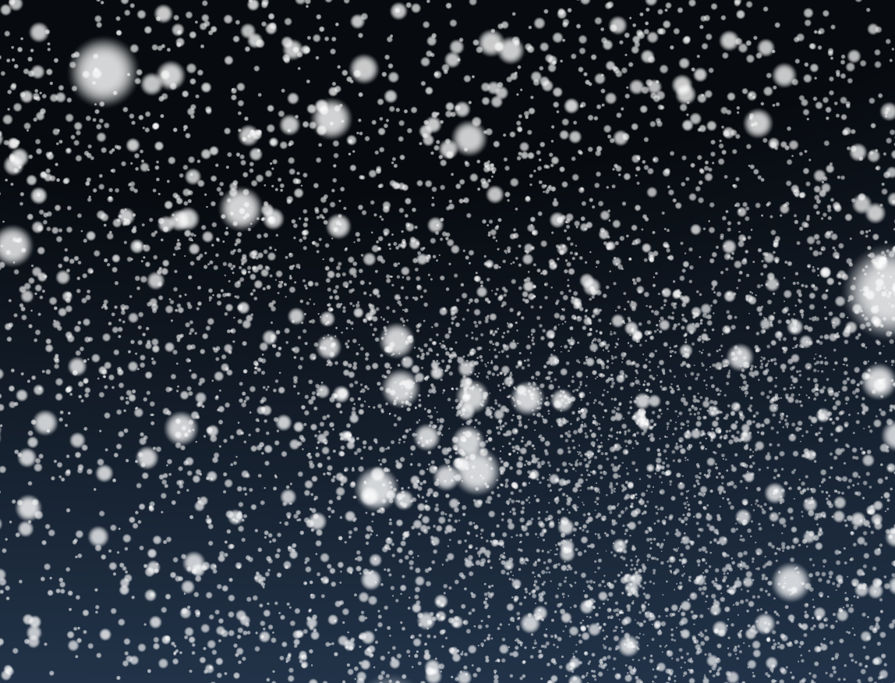
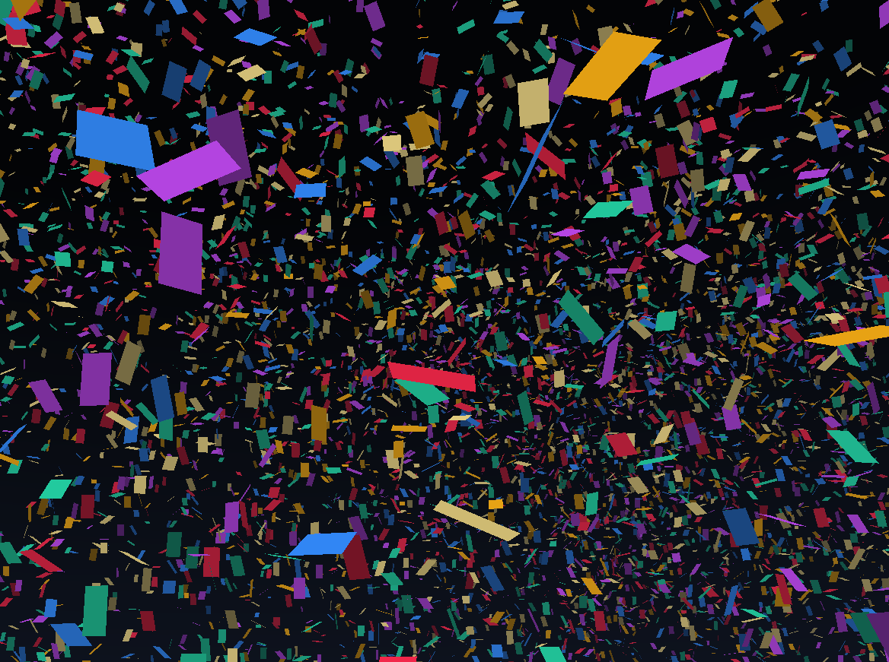

# ParticleScene

컴퓨트 셰이더를 이용한 GPU 파티클 테스트입니다.
RWStructuredBuffer에 파티클의 위치, 속도, 회전, 수명을 저장하고 GPU에서 병렬로 갱신합니다.
버텍스 셰이더가 같은 버퍼를 읽어 렌더링하므로 시뮬레이션 결과를 CPU로 가져올 필요가 없습니다.

| 눈 | 색종이 |
|:---:|:---:|
|  |  |

파티클 하나는 두 삼각형으로 만든 사각형이며, 전체 파티클을 인스턴싱으로 렌더링합니다.
정점 번호로 사각형의 모양을 만들고, 인스턴스 번호로 해당 파티클의 데이터를 읽습니다.
파티클 개수가 바뀌면 CPU에서 간접 드로우 인자를 갱신하고, DrawInstancedIndirect 한 번으로 제출합니다.

파티클 10만 개에서 약 2,400 FPS입니다.

성능 수치는 개발자 PC 기준입니다.
