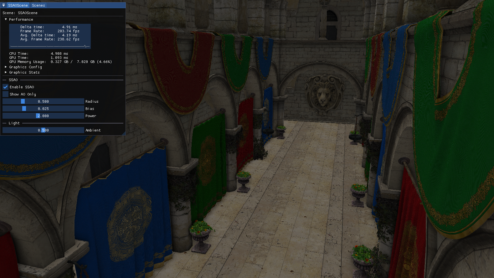
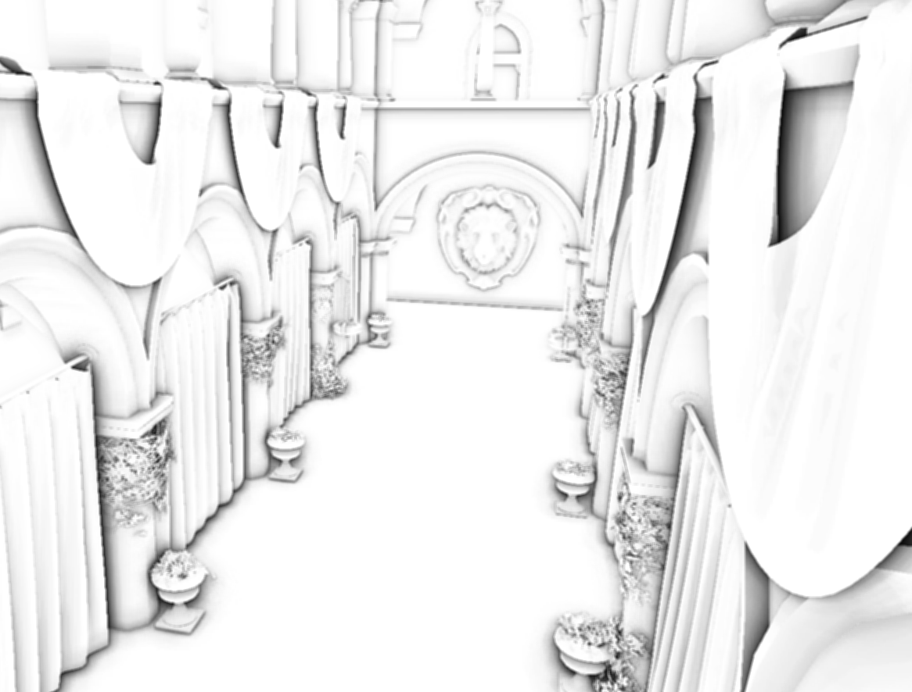

# SSAOScene

깊이와 노멀 버퍼로 주변광 차폐를 계산하는 SSAO(Screen Space Ambient Occlusion) 테스트입니다.
주변 표면에 의해 빛이 덜 닿는 부분을 어둡게 만들어 틈과 접촉 부위의 음영을 표현합니다.

| 최종 장면 | AO 결과 |
|:---:|:---:|
|  |  |

깊이에서 현재 픽셀의 뷰 공간 위치를 복원하고, 노멀 방향의 반구 안에 샘플을 배치합니다.
샘플을 화면에 투영해 깊이와 비교하며 주변 표면에 가려지는 정도를 구합니다.
노이즈 텍스처로 샘플 방향을 회전시키고 블러로 결과를 정리한 뒤, 최종 조명의 주변광에만 적용합니다.
