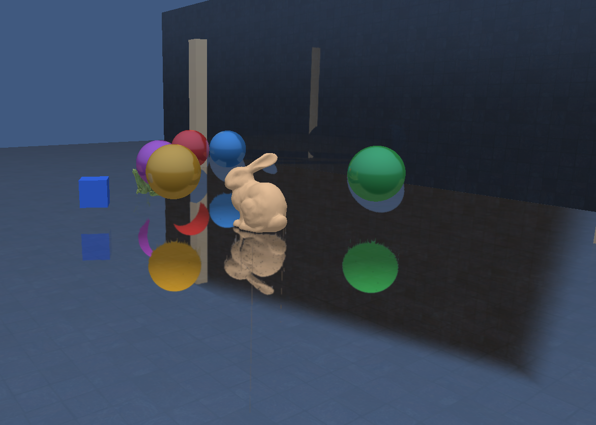
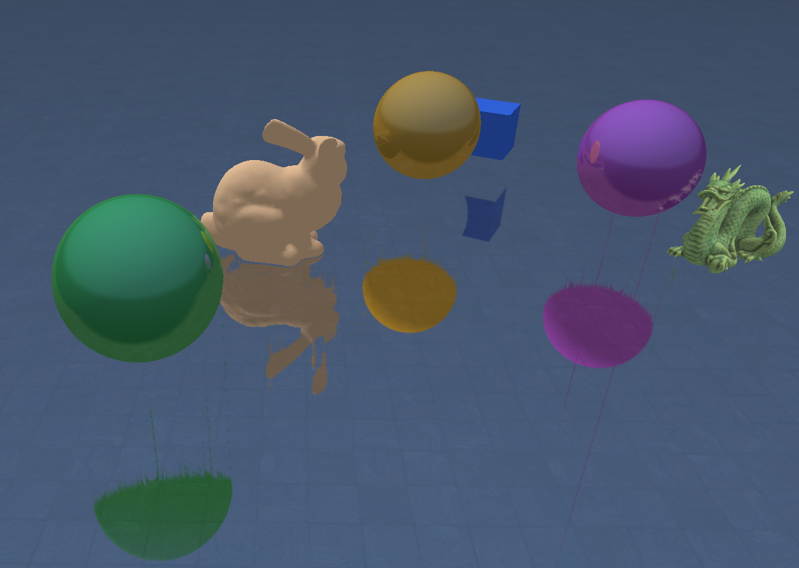

# SSRScene

화면에 렌더링한 정보를 이용해 반사를 만드는 SSR(Screen Space Reflection) 테스트입니다.
반사 표면에서 레이를 진행시키며 깊이 버퍼와 교차하는 위치를 찾고, 해당 위치의 색상을 반사색으로 사용합니다.

| 바닥과 구의 반사 | 다른 시점의 반사 |
|:---:|:---:|
|  |  |

교차 후보의 표면 방향을 검사하고, 색상을 섞을 때 깊이와 노멀을 함께 확인해 다른 물체의 색이 섞이는 현상을 줄입니다.
화면 가장자리와 교차가 불확실한 부분에서는 반사를 약하게 처리합니다.

화면 밖이나 다른 물체 뒤에 가려진 정보는 사용할 수 없다는 한계가 있습니다.
Fallback을 켜면 반사를 찾지 못한 부분을 하늘·지면 방향에 따라 계산한 배경색으로 채웁니다.
