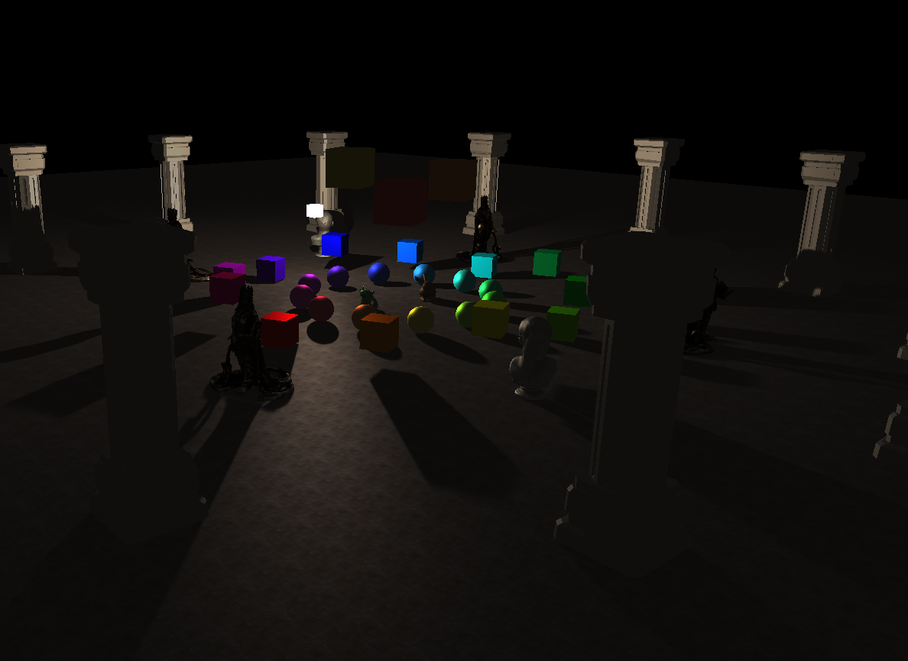
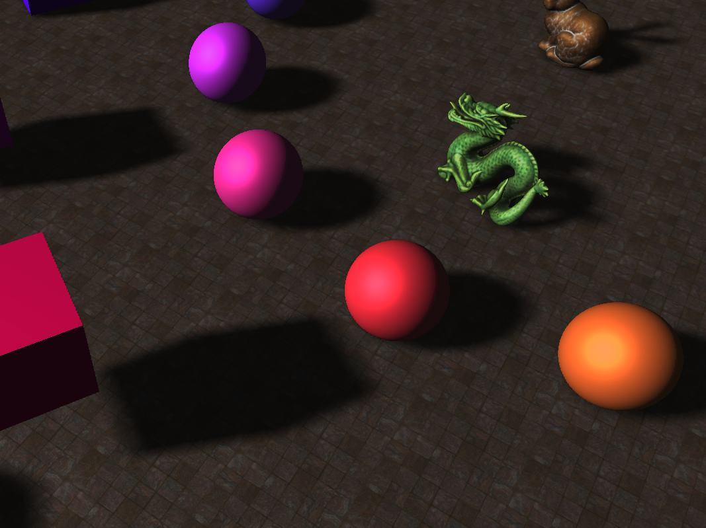

# ShadowScene

광원에서 바라본 깊이를 저장한 뒤, 표면의 깊이와 비교하는 섀도 매핑을 구현했습니다.
광원과 해당 표면 사이에 다른 물체가 있으면 해당 위치를 그림자로 처리합니다.

| 기둥과 동상의 그림자 | 모델 주변의 그림자 경계 |
|:---:|:---:|
|  |  |

점광원에는 여섯 방향의 깊이를 2D 텍스처 배열에 저장하는 Omni Shadow Mapping을 사용합니다.
스팟라이트는 광원 시점의 깊이를 한 장 저장합니다.
방향광에는 카메라의 가시 거리를 네 구간으로 나누는 Cascaded Shadow Mapping을 사용해 가까운 영역에 더 많은 해상도를 배분합니다.

Hard는 깊이를 한 번 비교하고, PCF는 주변의 비교 결과를 평균내어 경계를 부드럽게 만듭니다. PCF는 3×3, 5×5, 7×7을 지원합니다.
VSM은 깊이와 깊이의 제곱을 저장하고, 두 값으로 구한 분산을 이용해 그림자를 근사합니다.
광원 종류, 필터, 섀도 맵 해상도를 바꾸며 결과를 비교할 수 있습니다.
