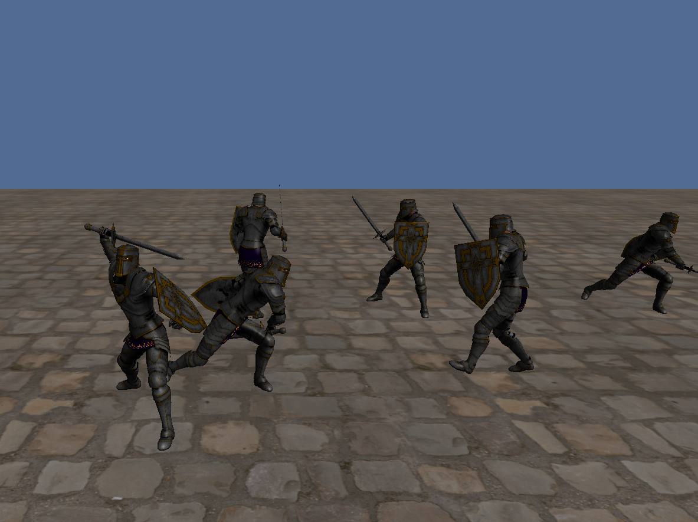
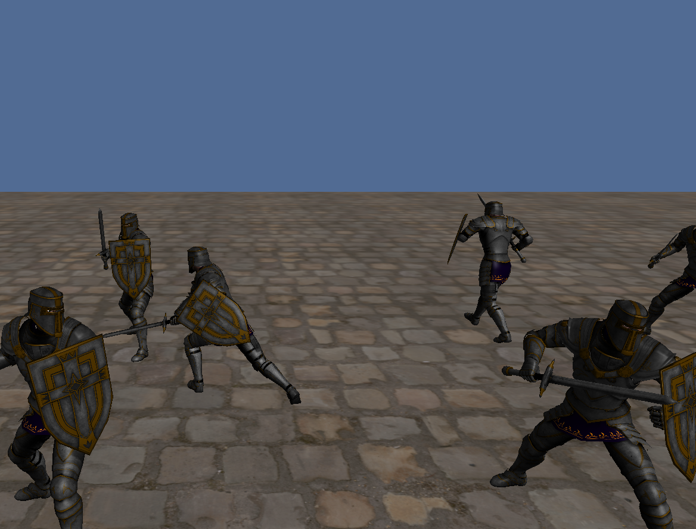

# SkinningScene

선형 블렌딩 스키닝을 이용한 캐릭터 애니메이션 테스트입니다.
Idle, Walk, Slash를 재생하고, 상태가 바뀔 때 이전 자세와 새 자세를 블렌딩해 자연스럽게 연결합니다.

| 캐릭터 애니메이션 | 자세에 따른 메시 변형 |
|:---:|:---:|
|  |  |

CPU에서 조인트별 스키닝 행렬을 계산해 상수버퍼로 전달합니다.
버텍스 셰이더에서는 정점마다 저장된 조인트 번호와 가중치로 행렬을 섞어 메시를 변형합니다.
WASD로 이동하고 Space로 Slash를 재생합니다.
