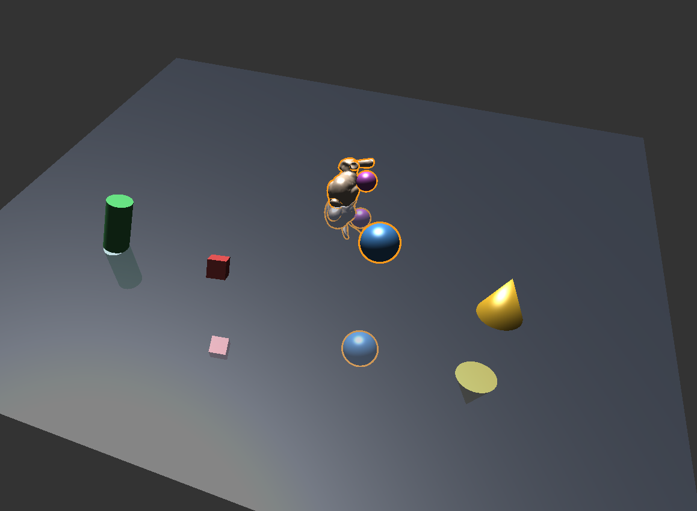
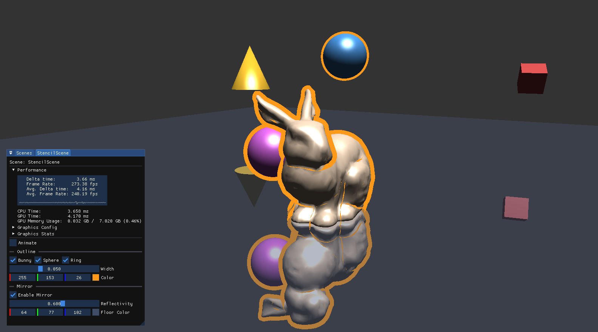

# StencilScene

스텐실 버퍼를 이용한 평면 반사와 아웃라인 테스트입니다.
스텐실에 기록한 값을 조건으로 사용해 오브젝트가 그려지는 영역을 제한합니다.

| 평면 반사와 아웃라인 | 모델의 외곽선 |
|:---:|:---:|
|  |  |

평면 반사는 y=0 기준의 반사 행렬로 오브젝트를 한 번 더 렌더링합니다.
거울 영역에 스텐실을 기록해 반사된 오브젝트가 그 안에서만 보이도록 합니다.

아웃라인은 원래 오브젝트를 그리며 스텐실에 1을 기록합니다.
이후 정점을 노멀 방향으로 밀어 확장한 모델을 그리되, 스텐실이 1인 부분은 제외합니다.
원래 모델의 바깥으로 나온 부분만 남아 외곽선이 됩니다.
