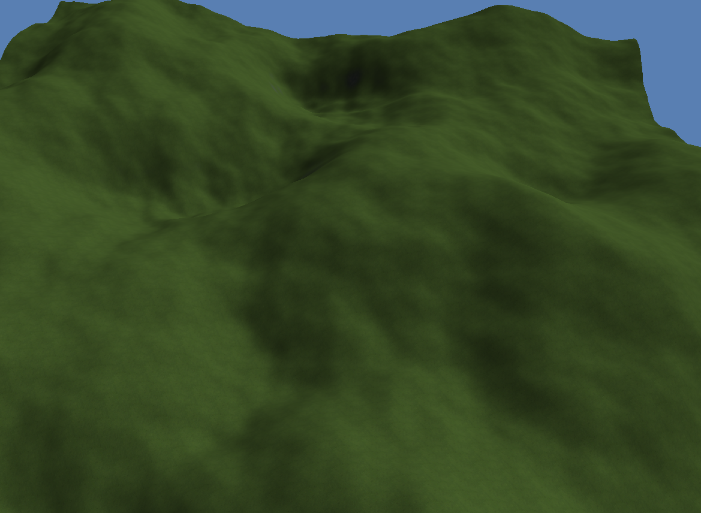
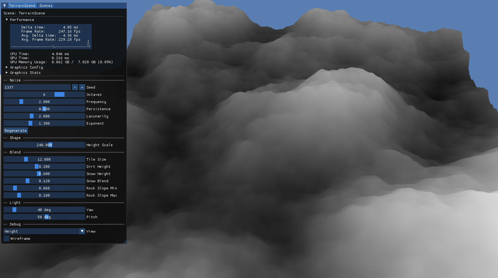
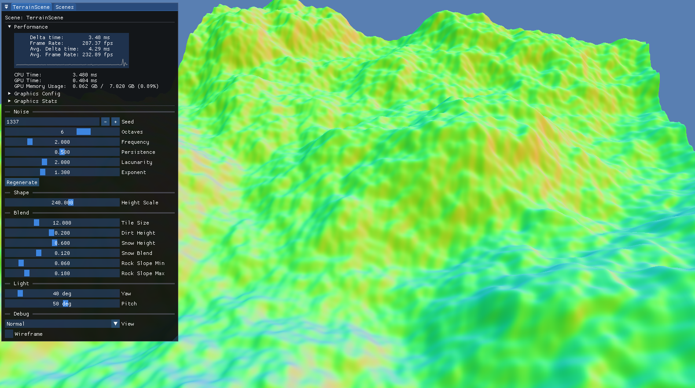

# TerrainScene

Perlin Noise를 여러 옥타브로 합쳐 지형을 생성합니다.
CPU에서 높이맵을 만들고, 버텍스 셰이더에서 높이를 읽어 격자 정점을 위아래로 이동시킵니다.

인접한 높이의 차이로 노멀을 계산해 지형의 경사에 맞게 조명을 적용합니다.
높이와 경사에 따라 풀, 바위, 눈, 흙 텍스처를 섞습니다.
높이와 노멀을 따로 표시하면 지형의 형태와 조명에 사용하는 데이터를 살펴볼 수 있습니다.

| 높이 시각화 | 노멀 시각화 |
|:---:|:---:|
|  |  |
