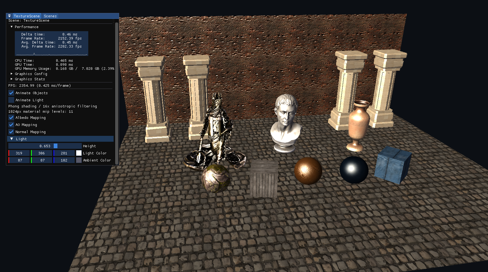

# TextureScene

알베도, 노멀, AO 텍스처를 적용한 기본적인 텍스처 매핑 테스트입니다.
알베도는 표면의 색상을 정하고, 노멀 맵은 조명 계산에 사용하는 노멀을 바꿔 작은 굴곡을 표현합니다.
AO는 틈이나 접촉 부위처럼 빛이 덜 닿는 부분을 어둡게 표현합니다.

기둥과 동상 모델에 텍스처를 적용했습니다. 각 텍스처를 켜고 끄면서 표면의 색과 굴곡, 음영의 차이를 볼 수 있습니다.

